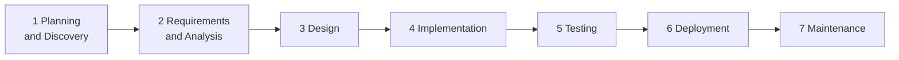

# AI Delivery Playbook

> I take products from business idea to production — end to end — using AI-driven development.

A practical, reusable process for delivering software with a team of AI agents (Claude Code) across the whole software development life cycle. AI drafts; one human decides at every gate. Short projects (1–2 weeks) run it as Waterfall: each phase is completed and locked once.

## The life cycle



| Phase | Question | Locked output | Gate |
|---|---|---|---|
| 1 Planning and Discovery | What do we build, for whom? | Proposal: options, scope, metric, timeline, budget | G1 |
| 2 Requirements and Analysis | What exactly must it do? | PRD, real-data analysis, user stories | G2 |
| 3 Design | How will we build it? | Spec and contracts, ADRs, C4, UI, test strategy, eval plan, plan and roles | G3 |
| 4 Implementation | Does it work? | Code and tests, built by role sessions | G4 |
| 5 Testing | Does it meet the requirements? | Test and eval report | G5 |
| 6 Deployment | Is it live and safe? | Release checklist and notes | G6 |
| 7 Maintenance | Does it keep working; what next? | Case study, next-phase backlog | — |

- **AI owns the draft:** proposal, PRD, data analysis, spec, ADRs, UI, tests, code, release notes.
- **Human owns the decision:** scope, architecture, UI, merge, deploy. Agents check each gate first with `/gate`.
- **Lock once:** new ideas after a gate go to the next-phase backlog instead of changing a locked document.
- **Sessions follow the phases:** the Lead session starts in phase 1, UI/UX in phase 3, Dev, DevOps and Test in phase 4, each working only in its own files.
- **Every task is logged:** what AI did, where the human stepped in, how much rework.

Full process: [docs/process.md](docs/process.md) · Agent team: [docs/agent-team.md](docs/agent-team.md) · Worked examples: [AI article finder](docs/examples/ai-article-finder.md) · [EA DCA Hedging](docs/examples/ea-dca-hedging.md)

## What a client gets

| Phase | Deliverable you review and approve |
|---|---|
| 1 Planning and Discovery | Proposal with options, effort, risks, scope, timeline and budget |
| 2 Requirements and Analysis | PRD with success metrics; analysis of your real data (the data stays in your environment); user stories |
| 3 Design | UI design and clickable prototype; spec with interface contracts; C4 diagrams; architecture decisions (ADRs); test and evaluation plan |
| 4–5 Implementation, Testing | Working software with automated tests; test and evaluation report |
| 6–7 Deployment, Maintenance | Release checklist and notes; case study and next-phase proposal |

## Templates

| Phase | Template |
|---|---|
| 1 Planning and Discovery | [Proposal](templates/proposal.md) |
| 2 Requirements and Analysis | [PRD](templates/prd.md) · [Data notes](templates/data-notes.md) · [User story](templates/user-story.md) |
| 3 Design | [Spec](templates/spec.md) · [ADR](templates/adr.md) · [C4 diagrams](templates/c4.md) · [Test strategy](templates/test-strategy.md) · [Eval plan](templates/eval-plan.md) · [Roles](templates/roles.md) · [Board](templates/board.md) |
| 6 Deployment | [Release checklist](templates/release-checklist.md) |
| 7 Maintenance | [Case study](templates/case-study.md) |

## Claude Code kit

| File | Use |
|---|---|
| [kit/CLAUDE.md](kit/CLAUDE.md) | Sample project `CLAUDE.md`: read-first links, commands, conventions, hard rules |
| [kit/hooks/pre-commit](kit/hooks/pre-commit) | Secret check: blocks `.env` files and credential-like values |
| [kit/commands/gate.md](kit/commands/gate.md) | `/gate <G#>`: the agent checks a gate against the repo and reports what is missing |

Set up a new project:

```bash
cp <playbook>/kit/CLAUDE.md ./CLAUDE.md
mkdir -p .claude/commands && cp <playbook>/kit/commands/gate.md .claude/commands/
cp <playbook>/kit/hooks/pre-commit .git/hooks/pre-commit && chmod +x .git/hooks/pre-commit
```

## Projects built with this playbook

| Project | What it proves | Status |
|---|---|---|
| [AI article finder](docs/examples/ai-article-finder.md) | Retrieval-only AI (FAQ + hybrid article search), evaluation, data kept in-country, five-session agent team, Waterfall in one week | Implementation (demo 18/10/2026) |
| [EA DCA Hedging](docs/examples/ea-dca-hedging.md) | POC rebuilding a black-box trading bot (MetaTrader 5): requirements recovered from the old bot's real trade history, rule-by-rule human decisions, backtest-based acceptance | Requirements and Analysis |
| News site frontend modernization | Legacy ASP.NET WebForms → ASP.NET Core, strangler fig | Planned |

## License

[](https://creativecommons.org/licenses/by/4.0/)

This playbook and its templates are licensed under [Creative Commons Attribution 4.0 International](LICENSE). You may use, adapt and share them, including commercially, as long as you give credit: "AI Delivery Playbook by Hai Nguyen (github.com/liquizzz/ai-delivery-playbook)".
