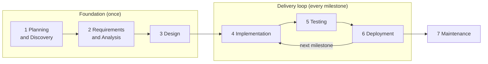

# AI Delivery Playbook

> I take products from business idea to production — end to end — with one human and a team of AI agents.

A practical, reusable operating model for delivering software with Claude Code role sessions (PO, Lead, Dev, Test, UI/UX, DevOps). AI drafts and builds; one human, the **owner**, decides at every gate. Projects run a **Foundation** stage once (phases 1–3), then ship in small **milestones** (phases 4–6), with a versioned SRS, GitHub issues as the work log and guardrails that keep each role in its lane.

## The life cycle

| Phase | Question | Output | Gate |
|---|---|---|---|
| 1 Planning and Discovery | What do we build, for whom? | Proposal: options, scope, metric, timeline, budget | G1 |
| 2 Requirements and Analysis | What exactly must it do? | PRD, real-data analysis, user stories | G2 |
| 3 Design | How will we build it? | SRS baseline, ADRs, C4, UI, test strategy, eval plan, first milestone | G3 |
| 4 Implementation | Does it work? | Code and tests through PRs, per milestone | G4 |
| 5 Testing | Does it meet the SRS? | Regression and eval report on staging | G5 |
| 6 Deployment | Is it released and safe? | Tagged version, changelog, SRS revision, release summary | G6 |
| 7 Maintenance | Does it keep working; what next? | Hotfixes, next milestones, case study | — |

- **The owner decides, AI drafts:** the morning plan, L2–L3 changes, scope and dates, every release and deployment, money, accounts and secrets.
- **Change through CRs, not freezes:** every change is a CR issue; every CR updates the always-current SRS before code starts.
- **Small releases:** 1–3 CRs per milestone, semantic version computed from issue labels, owner approves each release.
- **Roles in their lanes:** one session and one git worktree per role; only the Lead merges; a hook enforces push and path rules.
- **Nothing lives only in chat:** issues, documents and git are the source of truth, so any session can restart and continue.
- **Every task is logged:** what AI did, where the human stepped in, how much rework.

Full process: [docs/process.md](docs/process.md) · Agent team operating model: [docs/agent-team.md](docs/agent-team.md) · Project setup: [kit/github-setup.md](kit/github-setup.md)

## What a client gets

| Stage | Deliverable you review and approve |
|---|---|
| 1 Planning and Discovery | Proposal with options, effort, risks, scope, timeline and budget |
| 2 Requirements and Analysis | PRD with success metrics; analysis of your real data (the data stays in your environment); user stories |
| 3 Design | Clickable prototype; SRS with numbered requirements; C4 diagrams; architecture decisions (ADRs); test and evaluation plan |
| Every milestone (a small release) | A staging demo; a release summary with version, changes, test results and risks to approve |
| Go-live and after | Release notes and changelog per version; rollback plan; case study and next-phase proposal |

## Templates

| Stage | Template |
|---|---|
| 1 Planning and Discovery | [Proposal](templates/proposal.md) |
| 2 Requirements and Analysis | [PRD](templates/prd.md) · [Data notes](templates/data-notes.md) · [User story](templates/user-story.md) |
| 3 Design | [SRS](templates/srs.md) · [ADR](templates/adr.md) · [C4 diagrams](templates/c4.md) · [Test strategy](templates/test-strategy.md) · [Eval plan](templates/eval-plan.md) |
| Delivery loop | [CR](templates/cr.md) · [DEC](templates/dec.md) · [Spec per CR](templates/spec.md) · [Milestone](templates/milestone.md) · [Daily report](templates/daily-report.md) · [Test cases](templates/test-cases.md) · [Test report](templates/test-report.md) · [Release](templates/release-checklist.md) · [Changelog](templates/changelog.md) |
| 7 Maintenance | [Case study](templates/case-study.md) |

## Claude Code kit

| Path | Use |
|---|---|
| [kit/CLAUDE.md](kit/CLAUDE.md) | Shared project `CLAUDE.md`: roles, owner gates, rules, compact instructions |
| [kit/.claude/roles/](kit/.claude/roles/) | One file per role: PO, Lead, Dev, Test, UI/UX, DevOps |
| [kit/.claude/hooks/role-guard.cjs](kit/.claude/hooks/role-guard.cjs) | Push, merge and path rules per role; owner approval prompts for releases (with tests) |
| [kit/.claude/settings.json](kit/.claude/settings.json) | Registers the hook; shared allow and deny rules |
| [kit/.github/](kit/.github/) | Issue forms (CR, Task, Defect, Design), PR template, workflows (CI, docs check, design, staging, production) |
| [kit/scripts/](kit/scripts/) | `new-role-worktree`, `setup-labels`, `release` (version from labels, changelog, SRS revision) |
| [kit/commands/gate.md](kit/commands/gate.md) | `/gate <G#>`: the agent checks a gate against the repo and GitHub |
| [kit/hooks/pre-commit](kit/hooks/pre-commit) | Secret check: blocks `.env` files and credential-like values |
| [kit/github-setup.md](kit/github-setup.md) | Step-by-step setup of a new project, worktrees, GitHub board and pipelines |

## Projects built with this playbook

| Project | What it proves | Status |
|---|---|---|
| — | Worked examples will be added as projects are delivered with this process. | — |

## License

This playbook and its templates are licensed under [Creative Commons Attribution 4.0 International](LICENSE). You may use, adapt and share them, including commercially, as long as you give credit: "AI Delivery Playbook by Hai Nguyen (github.com/liquizzz/ai-delivery-playbook)".
