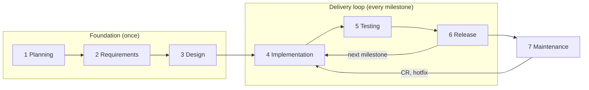

# Chapter 0 — Introduction

**Purpose:** build a real product with Claude Code the way a disciplined team would: clear roles, written requirements, small reviewed changes, tested releases, and one human who decides what goes live.

## The model

- **You are the owner.** You talk mostly to the PO session, decide at a few gates, and approve every release.
- **Each role is one Claude Code session** with its own git worktree and role file. Sessions do the work and report back.
- **Everything lives in GitHub issues, repo documents and git**, so any session can restart and continue.

## Principles

1. You decide; AI drafts and builds.
2. Every phase ends at a gate that only you pass.
3. Every change is a change request (CR) and updates the always-current SRS.
4. Decided means written, the moment it is decided.
5. Requirements and spec are merged before any code for them starts.
6. Small, frequent releases.
7. Every task is logged in `docs/ai-log.md`.

## The life cycle

## Choose the level of process

The stakes decide, not the size.

| Use | When |
|---|---|
| **Full process** | Real users, a client, money, security or personal data are involved, even for a short project |
| **[Lite mode](08-lite-mode.md)** | Low stakes: a POC, an internal tool, a weekend build. Move to Full when the stakes rise |
| **No process needed** | A one-off script or a spike you will throw away |

## How each task is written in this book

> **What it does** — why you would do it.
>
> **Ask** — the session to talk to and a prompt to copy.
>
> **Claude asks you** — the questions the session will ask before it starts. Answer them in one reply.
>
> **Claude does** — what the session then does on its own, in full.
>
> **You check** — what you read or decide.
>
> **Claude asks before** — actions that open an approval prompt for you.

Every session follows the rule **"ask first, then finish"** from the kit's `CLAUDE.md`: if your request lacks something, it asks all its questions in one numbered list with a proposed answer for each, waits, then completes the whole task. So prompts can stay short; the questions fill the gaps. Answer "use your proposals" to accept every proposed answer.

## Chapters

| Chapter | Use it to |
|---|---|
| [1 Setup](01-setup.md) | Start a project and open the first sessions |
| [2 The team](02-the-team.md) | Know which session does what and how work moves |
| [3 Foundation](03-foundation.md) | Get proposal, requirements and design approved |
| [4 The delivery loop](04-delivery-loop.md) | Plan milestones, turn requests into tasks, run the day |
| [5 Releases](05-releases.md) | Release, deploy, hotfix, roll back |
| [6 Continuity](06-continuity.md) | Restart, compact, switch machines without losing work |
| [7 Front-end projects](07-frontend-projects.md) | Show design to the client while the product is built |
| [8 Lite mode](08-lite-mode.md) | Run a smaller version |
| Appendices | [A Templates](appendix-a-templates.md) · [B Kit](appendix-b-kit.md) · [C FAQ](appendix-c-faq.md) |

## Words

| Term | Meaning |
|---|---|
| Owner | You: the human who decides |
| Session | One Claude Code desktop conversation playing one role |
| CR | Change request: a GitHub issue describing a business change |
| SRS | The always-current description of what the system does |
| Spec | Technical detail of one CR |
| DEC / ADR | Recorded business / technical decision |
| Milestone | The next release: a few CRs, shipped within days |
| L0–L3 | Change level of a task; decides how much testing it needs |
| Gate | A checklist you pass at the end of a phase (G1–G6) |
