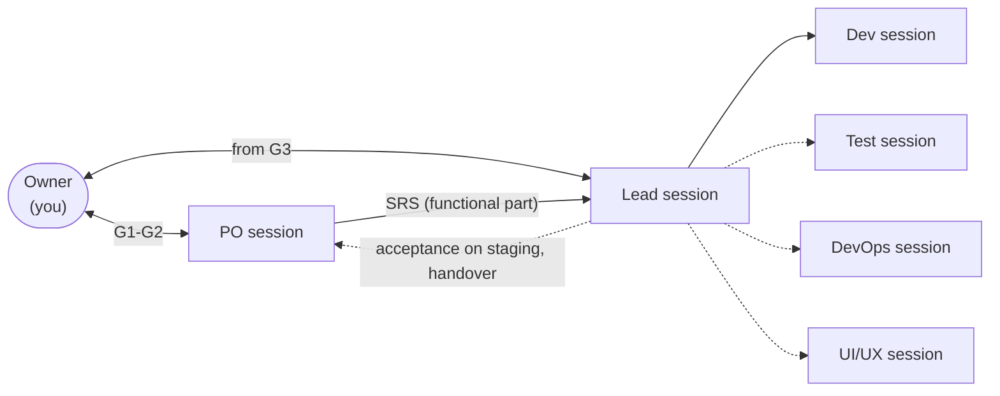
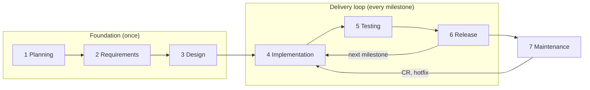

# Chapter 0: Introduction

**Purpose:** build a working product or demo with Claude Code step by step, with every step recorded so it can be fixed or changed later.

## Who this book is for

Anyone can build high-quality software from zero with this book, whether you code or not. You direct the Claude Code sessions the way you would direct a small team: you decide what to build and approve the results, and the sessions write the planning documents, code, tests and releases. Every decision is written down, so you can always see why the product works the way it does.

**What you need to know:** how to install a few tools and type a command in a terminal; [How to run](../../HOW-TO-RUN.md) shows each one. You do not need to know git, GitHub or Docker beforehand: the sessions use them for you and tell you what to look at. Everything else (worktrees, hooks, pipelines) is set up and run by Claude.

| Your experience | What this book gives you |
|---|---|
| You have never written code | A team that writes it for you, and a process that tells you what to check at each step |
| You can run a project, use git and read an error | A framework to build a small working product or MVP |
| You are an experienced developer | A standard way to hand work to AI and keep it under control |
| You do not know yet where it will run | Start on your machine in Docker; choose hosting before go-live ([chapter 5](05-releases.md#2-go-live-first-production-release)) |

## What this book does not do

- It does not ask you to program. It teaches how to direct Claude Code to build, test and release software.
- It does not replace your judgement. Several AI roles do not make an independent check: if the PO misunderstands you, the Lead, Dev and Test can follow the same mistake. The process makes misunderstandings visible early (every role writes down what it understood), and you try the product yourself before each release ([chapter 5](05-releases.md)).
- It does not guarantee a correct, secure or stable product if gates, tests or your acceptance are skipped.
- It does not run your servers. Everything runs in Docker and each release is a versioned image. Before go-live the Lead suggests hosting options; you choose one and run it ([chapter 5](05-releases.md#2-go-live-first-production-release)).
- It does not run by itself. You open the sessions; they pick up work from issues ([chapter 2](02-the-team.md#5-how-automatic-it-is)).

## Quick start: from idea to demo

Lite ([chapter 8](08-lite-mode.md)) is the starting level: three sessions, PO, Lead and Dev1, that you direct like a small team. You run one command, then each step is one slash command the kit installs; Claude drafts the whole step at once and you correct it. When work moves to another session, the report ends with the session to open and a prompt in a box you copy with one click. The project gets the same steps in its own `START-HERE.md` ([How to run](../../HOW-TO-RUN.md)).

| # | Session | Type | You get |
|---|---|---|---|
| 1 | Terminal, then Lead | Run `node crewbook-build/kit/init.mjs`, then open Claude Code in the `lead` folder init created (`<project>-wt/lead`) and type `/setup` | Repo, kit, branches, the gate issues, and the PO's and Dev1's folders ([ch. 1](01-setup.md)) |
| 2 | PO | `/next <your idea>` | A one-page proposal and sketches of the main screens you approve once (G1 and G2); then the PRD, the stories and the functional part of the SRS, written without asking you again ([ch. 3](03-foundation.md)) |
| 3 | Lead | `/next` | One solution design with the look and feel that you approve once (G3); then the ADRs, the completed SRS and the v0.1.0 tasks; from here on the Lead is your one contact ([ch. 3](03-foundation.md)) |
| 4 | Dev1 | `/build try #<n>` while you look, `/build done #<n>` per finished task | Code you can try at once; then tests at each task's level and a PR the Lead merges ([ch. 4](04-delivery-loop.md)) |
| 5 | Lead | `/release` | The milestone on `staging`: Dev1's regression, the PO's acceptance and the handover, scenarios you try, then tagged v0.1.0 and its Docker image ([ch. 5](05-releases.md)) |
| 6 | Terminal | The commands in the "Run the release in Docker" step of `START-HERE.md` | v0.1.0 running in Docker on your machine |
| 7 | Lead, then Dev1 | Prove the loop: close the sessions, open new ones, `/change <one small feature>` | The change as CR, task and v0.1.1, picked up from the record alone |

If the new sessions in step 7 pick up the fix without you explaining anything, keep building. Move to Full when money, security or personal data comes in, or when someone must sign off each release.

## The model

Solid lines are the three sessions most projects run (Lite). Test, DevOps and UI/UX join at Full, only when there is work for them; the PO comes back at the end of each milestone.

You are the owner. You give the PO your idea and approve the proposal and the screen sketches (G1-G2); from G3 on you work with the Lead, decide at a few gates and approve every release. The PO answers to the client: it checks each milestone on `staging` and writes the handover. Each role is a separate Claude Code session with its own git worktree and role file. The work is written down in GitHub issues, repo documents and git, so a skipped step shows up, and any change can be traced and fixed later.

## Principles

1. You decide; AI drafts and builds.
2. Every phase ends at a gate that only you pass.
3. Every functional change is a CR with the client's approval, and every technical change an ADR; both update the always-current SRS.
4. Write each decision down as soon as it is made.
5. Requirements and spec are merged before any code for them starts.
6. Test what the change level requires, no more and no less.
7. Spend tokens only where they add value ([chapter 9](09-token-budget.md)).

## The life cycle

The full list of steps, in order, with a check for each: [Appendix D: Process checklist](appendix-d-checklist.md).

## Choose the level of process

Pick the level by what is at stake: even a small project that handles money needs Full. Most projects run on Lite.

| Level | Sessions | Use when |
|---|---|---|
| [Lite](08-lite-mode.md), the starting level | Three: PO, Lead, Dev | Most products, including ones other people use |
| Full | PO, Lead, Dev, and Test, UI/UX or DevOps when there is work for them | Money, security, personal data, or someone who signs off each release, even for a short project |
| No process needed | | A one-off script or a spike you will throw away |

There is no single-session level: one session playing every role runs slower than three sessions working side by side, and it hides the hand-offs you need to see. One Dev session is the default at every level. Add a second Dev (`dev2`) when two tasks can run in parallel; five or more sessions are hard for one owner to follow.

## How each task is written in this book

> **What it does:** why you would do it.
>
> **Ask:** the session to talk to and a prompt to copy.
>
> **Claude asks you:** what the session may ask: at most three questions together, each with its suggested answer.
>
> **Claude does:** what the session then does on its own, in full.
>
> **You check:** what you read or decide.
>
> **Claude asks before:** actions that open an approval prompt for you.

Every session follows "AI does the work; the owner decides" from the kit's `CLAUDE.md`. You say what you want in your own words (a product you want to copy, or an old system to replace, is a fine place to start). The session drafts at once, asks at most three questions together, each with its suggested answer, and marks its other guesses ⚠️. Redoing a draft costs the AI minutes, so correct it as often as you like; you approve once. Every document is written in plain words, and a technical one opens with "In short". A few words steer it:

- "suggest": Claude proposes ideas. Otherwise it drafts from what you said.
- "later": the topic goes under Open decisions and comes back only when a step needs it.
- "you decide": Claude settles the rest and lists its calls so you can change them.

> **Token tip** boxes in each chapter show where cost adds up and how to avoid it.

## Chapters

| Chapter | Use it to |
|---|---|
| [1 Setup](01-setup.md) | Start a project and open the first sessions |
| [2 The team](02-the-team.md) | Know which session does what and how work moves |
| [3 Foundation](03-foundation.md) | Picture the project, then how it is built, with two approvals |
| [4 The delivery loop](04-delivery-loop.md) | Ask for changes, run the day, test by level |
| [5 Releases](05-releases.md) | Release, deploy, hotfix, roll back |
| [6 Continuity](06-continuity.md) | Restart, compact, trace a change, switch machines |
| [7 Front-end projects](07-frontend-projects.md) | Show design rounds while the product is built |
| [8 Lite mode](08-lite-mode.md) | Run with three sessions; move to Full and back |
| [9 Token budget](09-token-budget.md) | Keep cost under control |
| Appendices | [A Templates](appendix-a-templates.md) · [B Kit](appendix-b-kit.md) · [C FAQ](appendix-c-faq.md) · [D Process checklist](appendix-d-checklist.md) · [E Standards map](appendix-e-standards.md) |

## Words

| Term | Meaning |
|---|---|
| Owner | You: the human who decides scope, priorities and releases |
| Session | One Claude Code desktop conversation playing one role (PO, Lead, Dev, Test, UI/UX, DevOps) |
| PO | Product owner: answers to the client. Turns your idea into the proposal and the screen sketches, then the PRD, the stories and the functional part of the SRS (G1-G2); at the end of each milestone checks it on `staging` against the acceptance criteria and writes the handover |
| Lead | Tech lead and your one contact from G3: the solution design, task plan, every change (CR or ADR), review, releases |
| Lite / Full | The two levels of process. Lite runs PO, Lead and Dev; Full adds Test, UI/UX and DevOps. Both test each milestone on `staging` |
| Phase | One of the seven stages of the life cycle, from 1 Planning to 7 Maintenance |
| Worktree | A separate folder of the same git repo, one per role, so sessions never edit the same files |
| Branch | A line of work in git. `role/<role>` per role; `dev` (integration) → `staging` (release candidate) → `main` (released) → `production` (live) |
| Issue | A GitHub item that tracks one piece of work: a CR, a task, a defect or a design round |
| Label | A tag on an issue, e.g. `type:feature`, `L2`, `sev:high`; labels drive the version number and the testing |
| PR (pull request) | A request to merge a branch into another, e.g. `role/dev1` → `dev`. It shows the code changes, runs the checks (CI) and is where the Lead reviews. Every change reaches `dev` through a PR that says `Closes #n` |
| CI | Automatic checks that run on every PR: lint, type check, tests, build |
| Merge | Applying a reviewed PR to the target branch; only the Lead merges |
| CR (change request) | A GitHub issue describing one functional change (what the client gets: a feature, behaviour, scope, date or price), with who asked, its impact and price, approved by the client before any work starts. A technical change is an ADR instead |
| SRS | Software Requirements Specification: the always-current description of what the system does, with numbered requirements (`FR-xxx`, `NFR-xxx`) and a revision history |
| PRD | Product requirements document: what the product must do in business terms, with its must-haves and non-goals |
| Story | One thing a user needs to do, with the criteria that show it works |
| Given/When/Then | The form of an acceptance criterion, written in the user's words with real example values: *Given* what is on the screen, *When* the user does something, *Then* what they see |
| Screen sketch | A plain grey page you can click through, with example data, that shows one main screen before anything is built (`docs/product/screens/`) |
| Solution design | The one document that shows how the product will be built: its parts, the stack and why, the data, the look and feel, the milestones and the risks (`docs/tech/solution-design.md`) |
| Spec | The technical detail of one CR: behaviour, contracts, data, tasks |
| DEC / ADR | A recorded business / technical decision, with the options that were rejected and why |
| Milestone | The next release: a few CRs, shipped in a day or so |
| Change level | How deep a task changes the system; it decides how much testing is required: |
| L0 Display | Only look, text or layout; no data or logic. *Button colour, typo, spacing, anything in `design/`.* Test: build and a quick look |
| L1 Setting | A default, name, configuration value or message; the logic stays the same. *Page size 10 → 20, a new label text.* Test: the changed spot |
| L2 Module logic | New or changed business logic inside one module. *A new filter, a new validation rule.* Test: that module's scenarios |
| L3 Core | Shared code, data structure, login and permissions, money, security, personal data, deleting data, or several modules at once. *A schema change, a price calculation, a new role.* Test: core scenarios, related modules and part of the regression |
| Regression | Re-running the important test scenarios of the whole product, on `staging`, before a release |
| Version (SemVer) | `MAJOR.MINOR.PATCH`, e.g. `v1.4.0`, computed from the issue labels |
| Tag | A fixed name for one version in git; every release on `main` has one |
| Docker image | A packaged, runnable copy of one part of the product (`app`, `design`), built per folder and tagged with the version, e.g. `app:v1.4.0` |
| Registry | Where the images are stored; the kit uses GitHub's (`ghcr.io`) |
| Gate | A checklist you pass at the end of a phase (G1-G6); `/gate` checks it first |
| Hotfix / Rollback | An urgent fix to production / putting the previous version back live |
| Compact | Shrinking a session's context (`/compact`) so it stays fast and cheap |
| Token | The unit Claude usage is measured and paid in |
