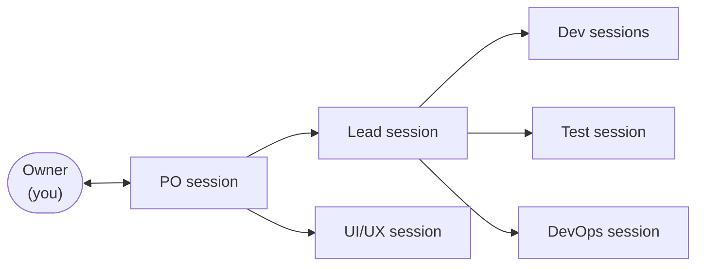
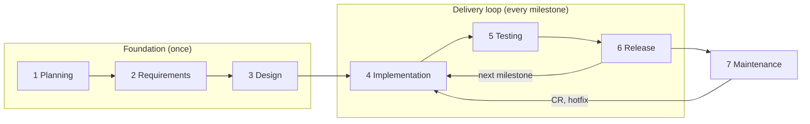

# Chapter 0: Introduction

**Purpose:** build a working product or demo with Claude Code quickly, without skipping a step, and with every step recorded so it can be fixed or changed later.

## Who this book is for

This book is for people with some technical background who want to turn an idea into working software fast. You can read code, use a terminal, and you know what git and GitHub are. You decide what to build and approve the results; Claude Code sessions do the planning documents, code, tests and releases.

**What you need to know:** run a command in a terminal; what a git branch and a commit are; how to open a GitHub repo and read an issue or a pull request; how to start and stop containers with Docker. Everything else (worktrees, hooks, pipelines) is set up and run by Claude.

| Your experience | What this book gives you |
|---|---|
| No programming, git or terminal yet | A map of the work, but learn the basics first; the book does not teach them |
| You can run a project, use git and read an error | A framework to build a small working product or MVP |
| You are an experienced developer | A standard way to hand work to AI and keep it under control |
| You do not know where or how you will deploy | Outside the scope of this book: decide your hosting first |

## What this book does not do

- It does not teach programming. It teaches how to direct Claude Code to build, test and release software.
- It does not replace your judgement. Several AI roles do not make an independent check: if the PO misunderstands you, the Lead, Dev and Test can follow the same mistake. The process makes misunderstandings visible early (every role writes down what it understood), and you try the product yourself before each release ([chapter 5](05-releases.md)).
- It does not guarantee a correct, secure or stable product if gates, tests or your acceptance are skipped.
- It does not choose or run your servers. Everything runs in Docker and each release is a versioned image; where it runs in production is your decision and your setup.
- It does not run by itself. You open the sessions; they pick up work from issues ([chapter 2](02-the-team.md#5-how-automatic-it-is)).

## Quick start: from idea to demo

Starter mode ([chapter 8](08-lite-mode.md)) is the fastest path: one session plays every role. You run one command, then each step is one prompt; Claude asks what it needs, then does the whole step. The project gets the same steps in its own `START-HERE.md` ([How to run](../../HOW-TO-RUN.md)).

| # | Say (to the one Starter session) | You get |
|---|---|---|
| 1 | Run `node <path>/kit/init.mjs` and choose `starter`, then open a session in the `lead` worktree: "Read CLAUDE.md and continue as lead. Finish the Starter setup: ask me the stack and commands, then fill in CLAUDE.md and the Docker files, and create milestone v0.1.0 on GitHub." | Repo, kit, branches, Docker files ([ch. 1](01-setup.md), [ch. 8](08-lite-mode.md)) |
| 2 | "Start phase 1 for `<idea>`. Interview me, then draft a one-page proposal." | Proposal with options ([ch. 3](03-foundation.md)) |
| 3 | "Proposal approved. Write a short PRD with stories." | PRD and stories |
| 4 | "Write the SRS baseline and plan milestone v0.1.0 as the thinnest end-to-end slice (screen → logic → data)." | SRS, first milestone, tasks |
| 5 | "Build milestone v0.1.0." | Code, tests by level ([ch. 4](04-delivery-loop.md)) |
| 6 | "Milestone v0.1.0 is done. Prepare the release and my acceptance test." | Scenarios you try, then tagged v0.1.0 ([ch. 5](05-releases.md)) |
| 7 | Prove the loop: close the session, open a new one, say "Read CLAUDE.md and continue as lead", then "Small change: `<one fix>`". | The fix as CR → task → v0.1.1, picked up from the record alone |

If the new session in step 7 picks up the fix without you explaining anything, keep building. Move to Lite or Full when the stakes rise.

## The model

You are the owner. You talk mostly to the PO, decide at a few gates and approve every release. Each role is a separate Claude Code session with its own git worktree and role file. The work is written down in GitHub issues, repo documents and git, so a skipped step shows up, and any change can be traced and fixed later.

## Principles

1. You decide; AI drafts and builds.
2. Every phase ends at a gate that only you pass.
3. Every change is a CR and updates the always-current SRS.
4. Write each decision down as soon as it is made.
5. Requirements and spec are merged before any code for them starts.
6. Test what the change level requires, no more and no less.
7. Spend tokens only where they add value ([chapter 9](09-token-budget.md)).

## The life cycle

The full list of steps, in order, with a check for each: [Appendix D: Process checklist](appendix-d-checklist.md).

## Choose the level of process

Pick the level by what is at stake. A three-day project that handles money still needs the full process.

| Use | When |
|---|---|
| Full process | Real users, a client, money, security or personal data are involved, even for a short project |
| [Lite mode](08-lite-mode.md) | Low stakes but more than one session's work: a POC, an internal tool. Move to Full when the stakes rise |
| [Starter mode](08-lite-mode.md#starter-mode) | A first demo or a throw-away POC, built by one session. Move to Lite as soon as real users or a second developer appear |
| No process needed | A one-off script or a spike you will throw away |

## How each task is written in this book

> **What it does:** why you would do it.
>
> **Ask:** the session to talk to and a prompt to copy.
>
> **Claude asks you:** the questions the session will ask before it starts. Answer them in one reply.
>
> **Claude does:** what the session then does on its own, in full.
>
> **You check:** what you read or decide.
>
> **Claude asks before:** actions that open an approval prompt for you.

Every session follows "ask first, then finish" from the kit's `CLAUDE.md`: if a request lacks something, it asks all its questions in one numbered list with a proposed answer for each, waits, then completes the whole task. Reply "use your proposals" to accept them all.

> **Token tip** boxes in each chapter show where cost adds up and how to avoid it.

## Chapters

| Chapter | Use it to |
|---|---|
| [1 Setup](01-setup.md) | Start a project and open the first sessions |
| [2 The team](02-the-team.md) | Know which session does what and how work moves |
| [3 Foundation](03-foundation.md) | Get proposal, requirements and design approved |
| [4 The delivery loop](04-delivery-loop.md) | Ask for changes, run the day, test by level |
| [5 Releases](05-releases.md) | Release, deploy, hotfix, roll back |
| [6 Continuity](06-continuity.md) | Restart, compact, trace a change, switch machines |
| [7 Front-end projects](07-frontend-projects.md) | Show design to the client while the product is built |
| [8 Starter and Lite modes](08-lite-mode.md) | Run with one session for a demo, or three for a small product |
| [9 Token budget](09-token-budget.md) | Keep cost under control |
| Appendices | [A Templates](appendix-a-templates.md) · [B Kit](appendix-b-kit.md) · [C FAQ](appendix-c-faq.md) · [D Process checklist](appendix-d-checklist.md) |

## Words

| Term | Meaning |
|---|---|
| Owner | You: the human who decides scope, priorities and releases |
| Session | One Claude Code desktop conversation playing one role (PO, Lead, Dev, Test, UI/UX, DevOps) |
| Worktree | A separate folder of the same git repo, one per role, so sessions never edit the same files |
| Branch | A line of work in git. `role/<role>` per role; `dev` (integration) → `staging` (release candidate) → `main` (released) → `production` (live) |
| Issue | A GitHub item that tracks one piece of work: a CR, a task, a defect or a design round |
| Label | A tag on an issue, e.g. `type:feature`, `L2`, `sev:high`; labels drive the version number and the testing |
| PR (pull request) | A request to merge a branch into another, e.g. `role/dev1` → `dev`. It shows the code changes, runs the checks (CI) and is where the Lead reviews. Every change reaches `dev` through a PR that says `Closes #n` |
| CI | Automatic checks that run on every PR: lint, type check, tests, build |
| Merge | Applying a reviewed PR to the target branch; only the Lead merges |
| CR (change request) | A GitHub issue describing one business change (feature, change or fix), approved before any work starts |
| SRS | Software Requirements Specification: the always-current description of what the system does, with numbered requirements (`FR-xxx`, `NFR-xxx`) and a revision history |
| Spec | The technical detail of one CR: behaviour, contracts, data, tasks |
| DEC / ADR | A recorded business / technical decision, with the options that were rejected and why |
| Milestone | The next release: a few CRs, shipped within days |
| Change level | How deep a task changes the system; it decides how much testing is required: |
| L0 Display | Only look, text or layout; no data or logic. *Button colour, typo, spacing, anything in `design/`.* Test: build and a quick look |
| L1 Setting | A default, name, configuration value or message; the logic stays the same. *Page size 10 → 20, a new label text.* Test: the changed spot |
| L2 Module logic | New or changed business logic inside one module. *A new filter, a new validation rule.* Test: that module's scenarios |
| L3 Core | Shared code, data structure, login and permissions, money, security, personal data, deleting data, or several modules at once. *A schema change, position sizing, a new role.* Test: core scenarios, related modules and part of the regression |
| Regression | Re-running the important test scenarios of the whole product, on `staging`, before a release |
| Version (SemVer) | `MAJOR.MINOR.PATCH`, e.g. `v1.4.0`, computed from the issue labels |
| Tag | A fixed name for one version in git; every release on `main` has one |
| Docker image | A packaged, runnable copy of one part of the product (`app`, `design`), built per folder and tagged with the version, e.g. `app:v1.4.0` |
| Registry | Where the images are stored; the kit uses GitHub's (`ghcr.io`) |
| Gate | A checklist you pass at the end of a phase (G1-G6); `/gate` checks it first |
| Hotfix / Rollback | An urgent fix to production / putting the previous version back live |
| Compact | Shrinking a session's context (`/compact`) so it stays fast and cheap |
| Token | The unit Claude usage is measured and paid in |
