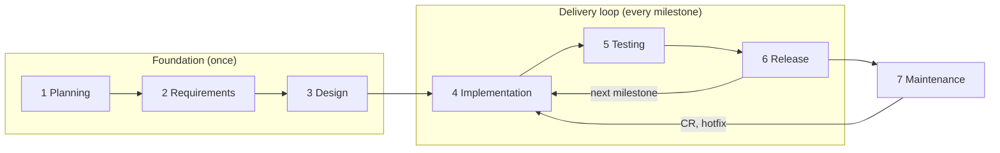

# Chapter 0 — Introduction

**Purpose:** build a working product or demo with Claude Code quickly, without skipping a step, and with every step recorded so it can be fixed or changed later.

## Who this book is for

Advanced users with some technical background — you can read code, use a terminal and know what git and GitHub are — who want to turn an idea into working software fast. You decide what to build and approve the results; Claude Code sessions do the planning documents, code, tests and releases.

**What you need to know:** run a command in a terminal; what a git branch and a commit are; how to open a GitHub repo and read an issue or a pull request. Everything else (worktrees, hooks, pipelines) is set up and run by Claude.

## Quick start: from idea to demo

Lite mode ([chapter 8](08-lite-mode.md)) is the fastest path. Each step is one prompt; Claude asks what it needs, then does the whole step.

| # | Session | Say | You get |
|---|---|---|---|
| 1 | New session in an empty folder | "Set up this folder as a project with the AI Delivery Playbook kit at `<path>`, Lite mode. Read `<path>/docs/book/01-setup.md` first. Ask me everything you need first." | Repo, kit, branches, PO and Lead worktrees ([ch. 1](01-setup.md)) |
| 2 | PO | "Start phase 1 for `<idea>`. Interview me, then draft a one-page proposal." | Proposal with options ([ch. 3](03-foundation.md)) |
| 3 | PO | "Proposal approved. Write a short PRD with stories." | PRD and stories |
| 4 | Lead | "Write the SRS baseline and plan milestone v0.1.0 as the thinnest working slice." | SRS, first milestone, tasks |
| 5 | Lead | "Open dev1 and build milestone v0.1.0." | Code through reviewed PRs ([ch. 4](04-delivery-loop.md)) |
| 6 | Lead | "Milestone v0.1.0 is done. Prepare the release." | Tagged demo version v0.1.0 ([ch. 5](05-releases.md)) |

Then keep asking the PO for changes; each becomes a CR, a task and the next version.

## The model

- **You are the owner.** You talk mostly to the PO, decide at a few gates and approve every release.
- **Each role is one Claude Code session** with its own git worktree and role file.
- **Everything is written down** in GitHub issues, repo documents and git, so nothing is skipped or forgotten, and any step can be traced and fixed later.

## Principles

1. You decide; AI drafts and builds.
2. Every phase ends at a gate that only you pass.
3. Every change is a CR and updates the always-current SRS.
4. Decided means written, the moment it is decided.
5. Requirements and spec are merged before any code for them starts.
6. Test what the change level requires, no more and no less.
7. Spend tokens only where they add value ([chapter 9](09-token-budget.md)).

## The life cycle

The full list of steps, in order, with a check for each: [Appendix D — Process checklist](appendix-d-checklist.md).

## Choose the level of process

The stakes decide, not the size.

| Use | When |
|---|---|
| **Full process** | Real users, a client, money, security or personal data are involved, even for a short project |
| **[Lite mode](08-lite-mode.md)** | Low stakes: a demo, a POC, an internal tool, a weekend build. Move to Full when the stakes rise |
| **No process needed** | A one-off script or a spike you will throw away |

## How each task is written in this book

> **What it does** — why you would do it.
>
> **Ask** — the session to talk to and a prompt to copy.
>
> **Claude asks you** — the questions the session will ask before it starts. Answer them in one reply.
>
> **Claude does** — what the session then does on its own, in full.
>
> **You check** — what you read or decide.
>
> **Claude asks before** — actions that open an approval prompt for you.

Every session follows **"ask first, then finish"** from the kit's `CLAUDE.md`: if a request lacks something, it asks all its questions in one numbered list with a proposed answer for each, waits, then completes the whole task. Reply "use your proposals" to accept them all.

> **Token tip** boxes in each chapter show where cost adds up and how to avoid it.

## Chapters

| Chapter | Use it to |
|---|---|
| [1 Setup](01-setup.md) | Start a project and open the first sessions |
| [2 The team](02-the-team.md) | Know which session does what and how work moves |
| [3 Foundation](03-foundation.md) | Get proposal, requirements and design approved |
| [4 The delivery loop](04-delivery-loop.md) | Ask for changes, run the day, test by level |
| [5 Releases](05-releases.md) | Release, deploy, hotfix, roll back |
| [6 Continuity](06-continuity.md) | Restart, compact, trace a change, switch machines |
| [7 Front-end projects](07-frontend-projects.md) | Show design to the client while the product is built |
| [8 Lite mode](08-lite-mode.md) | Run a smaller version for demos and POCs |
| [9 Token budget](09-token-budget.md) | Keep cost under control |
| Appendices | [A Templates](appendix-a-templates.md) · [B Kit](appendix-b-kit.md) · [C FAQ](appendix-c-faq.md) · [D Process checklist](appendix-d-checklist.md) |

## Words

| Term | Meaning |
|---|---|
| **Owner** | You: the human who decides scope, priorities and releases |
| **Session** | One Claude Code desktop conversation playing one role (PO, Lead, Dev, Test, UI/UX, DevOps) |
| **Worktree** | A separate folder of the same git repo, one per role, so sessions never edit the same files |
| **Branch** | A line of work in git. `role/<role>` per role; `dev` (integration) → `staging` (release candidate) → `main` (released) → `production` (live) |
| **Issue** | A GitHub item that tracks one piece of work: a CR, a task, a defect or a design round |
| **Label** | A tag on an issue, e.g. `type:feature`, `L2`, `sev:high`; labels drive the version number and the testing |
| **PR (pull request)** | A request to merge a branch into another, e.g. `role/dev1` → `dev`. It shows the code changes, runs the checks (CI) and is where the Lead reviews. Every change reaches `dev` through a PR that says `Closes #n` |
| **CI** | Automatic checks that run on every PR: lint, type check, tests, build |
| **Merge** | Applying a reviewed PR to the target branch; only the Lead merges |
| **CR (change request)** | A GitHub issue describing one business change (feature, change or fix), approved before any work starts |
| **SRS** | Software Requirements Specification: the always-current description of what the system does, with numbered requirements (`FR-xxx`, `NFR-xxx`) and a revision history |
| **Spec** | The technical detail of one CR: behaviour, contracts, data, tasks |
| **DEC / ADR** | A recorded business / technical decision, with the options that were rejected and why |
| **Milestone** | The next release: a few CRs, shipped within days |
| **Change level** | How deep a task changes the system; it decides how much testing is required: |
| — **L0 Display** | Only look, text or layout; no data or logic. *Button colour, typo, spacing, anything in `design/`.* Test: build and a quick look |
| — **L1 Setting** | A default, name, configuration value or message; the logic stays the same. *Page size 10 → 20, a new label text.* Test: the changed spot |
| — **L2 Module logic** | New or changed business logic inside one module. *A new filter, a new validation rule.* Test: that module's scenarios |
| — **L3 Core** | Shared code, data structure, login and permissions, **money, security, personal data, deleting data**, or several modules at once. *A schema change, position sizing, a new role.* Test: core scenarios, related modules and part of the regression |
| **Regression** | Re-running the important test scenarios of the whole product, on `staging`, before a release |
| **Version (SemVer)** | `MAJOR.MINOR.PATCH`, e.g. `v1.4.0`, computed from the issue labels |
| **Tag** | A fixed name for one version in git; every release on `main` has one |
| **Gate** | A checklist you pass at the end of a phase (G1–G6); `/gate` checks it first |
| **Hotfix / Rollback** | An urgent fix to production / putting the previous version back live |
| **Compact** | Shrinking a session's context (`/compact`) so it stays fast and cheap |
| **Token** | The unit Claude usage is measured and paid in |
