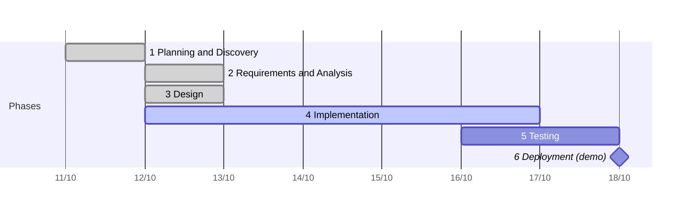

# Example: AI article finder (1–2 week project, Waterfall)

A real client project delivered with this playbook by one human and a team of five AI agent sessions. The client's name and data stay private; everything below is the delivery record.

| Field | Value |
|---|---|
| Client | The client (a Vietnamese online newspaper) |
| Product | "AI assistant" widget on the client's website: answers common questions from an editor-approved FAQ and finds published articles |
| Project type | Demo for the editorial board, built so the same code goes to production |
| Duration | 11–18/10/2026 (~40h of focused work) |
| Team | 1 human (solution lead) + 5 Claude Code sessions: Lead, UI/UX, Dev, DevOps, Test |

## Timeline

| # | Phase | Dates | Gate | Status |
|---|---|---|---|---|
| 1 | Planning and Discovery | 11/10 | G1 Proposal locked 11/10 | Done |
| 2 | Requirements and Analysis | 12/10 | G2 Requirements locked 12/10 | Done |
| 3 | Design | 12/10 | G3 Design locked 12/10 | Done |
| 4 | Implementation | 12–16/10 | G4 Build complete | In progress |
| 5 | Testing | 16–17/10 | G5 Accepted | Planned |
| 6 | Deployment | 18/10 | G6 Demo released | Planned |
| 7 | Maintenance | After the demo | — | Planned |

## 1. Planning and Discovery (11/10, proposal locked)

**Problem.** Readers cannot easily find past coverage of a case, a place or a topic: the site search is keyword-only and there is no assistant. Common questions (hotlines, how to contact the newsroom, public-service procedures) have no quick answer on the site.

**Constraints.** Reader questions and client content must stay in Vietnam; no foreign AI APIs on client data. Read-only access to the client's database. The assistant must never say something the newspaper has not published or approved.

**Options compared.**

| Option | What it is | Demo effort | Main risk |
|---|---|---|---|
| 1A | AI writes answers from retrieved articles | ~65–105h | Data transfer abroad needs a legal impact assessment; AI may misstate facts under the paper's name |
| **1B (chosen)** | AI only **finds** content: approved FAQ answers verbatim, published articles as cards with links | ~40–60h | Search quality in Vietnamese (accents, word segmentation) |

**Locked scope.** Option 1B, runs fully in Vietnam, demo on 18/10, ~40h. Out of scope: AI-written answers, article summaries, reader accounts, production hardening.

## 2. Requirements and Analysis (12/10, requirements locked)

**Two flows**

1. **Q&A:** the question is matched against the editor-approved FAQ; a match returns the approved answer word for word; no match returns a fixed "not covered yet" message and an offer to search articles.
2. **Article search:** hybrid search (semantic + sparse + keyword, works without accents) returns cards with title, excerpt, date, section and link: 5 first, then 10 more per click, up to 100.

**Must-haves.** Indexer reading a copy of the client's database; visibility rule (only published articles inside their publish/expiry window); sync of new, edited and removed articles every 3–5 minutes; topic filter (sensitive and out-of-scope questions get a fixed, polite answer); API; embeddable widget for desktop and mobile; evaluation harness; demo deployment with Docker.

**Success metrics.**

| Metric | Target |
|---|---|
| hit@5: a correct article in the first 5 cards | ≥ 85% on a 100-question set |
| Correct refusal for sensitive and out-of-scope questions | 100% on the test subset |
| API latency p95 (warm cache) | ≤ 1.5 s |
| Empty answer boxes | 0 |
| Hidden articles shown (removed, scheduled, expired) | 0 |

**Real data analysis.** A backup of the client's content database was restored on a local machine (never in git or the cloud). The analysis mapped every product field to its source: article table and text fields, the "published" status, the publish/expiry window, the primary section, the article URL, and the time zone of stored dates (local time, converted to UTC).

## 3. Design (12/10, design locked)

| Artifact | Content |
|---|---|
| UI design (UI/UX session) | 3 screens, 10 states, desktop and mobile; clickable prototype on mock data; one embed line plus one script; one friendly error message for every failure |
| Spec | Indexing and sync pipeline, search flow, visibility rules, abuse protection (rate limits, caching, a cap on concurrent embedding), error handling, and the API contract written to serve the approved UI |
| ADR-0001 | Index store: Postgres + pgvector (one database for vectors, keywords and metadata) |
| ADR-0002 | Embedding model: bge-m3, self-hosted (multilingual, dense + sparse vectors, no data leaves the country) |
| ADR-0003 | API and indexer: Python + FastAPI |
| ADR-0004 | Hosting: Docker on a local machine for the demo; a Linux VM at a Vietnamese cloud provider for production |
| Test strategy and eval plan | Unit tests with TDD; integration tests on synthetic rows in the local copy; API and load tests; 100-question eval set with the pass marks above |
| Plan and roles | Roadmap by role, owned paths per role, hand-off points, board |

## 4. Implementation (12–16/10)

Sessions opened at the start of the phase, each with its own plan written from the approved spec:

| Session | Work |
|---|---|
| Lead | Board, daily review, gate checks, AI log |
| UI/UX | Widget built from the approved design; tested on copies of live pages: no CSP violations, no layout shift |
| DevOps | Local stack (source database copy + Postgres/pgvector), read-only and test logins, secret check |
| Dev | Indexer with TDD (100+ unit tests); first 1,000 articles indexed and benchmarked on CPU and GPU; next: search API |
| Test | Integration scenarios and the eval set |

The FAQ content for the Q&A flow is drafted by AI from the client's official public pages and reviewed by the editors before it goes live.

## 5–7. Testing, Deployment, Maintenance (planned)

- **Testing (16–17/10):** integration, API, load tests and the 100-question eval; results against the success metrics.
- **Deployment (18/10):** demo on the local Docker stack with the release checklist.
- **Maintenance (after the demo):** full archive indexing, scheduled sync and cleanup, production on the client's cloud VM, and a growth loop that turns unanswered questions into new FAQ entries after editorial review.

## AI and human split

| Phase | AI did | Human decided |
|---|---|---|
| Planning | Compared options with effort and legal risk; drafted the proposal | Chose 1B; agreed scope and date |
| Requirements | Drafted the PRD; mapped the real data | Confirmed business rules and the two flows |
| Design | Drafted spec, contracts, 4 ADRs, UI states, prototype, test strategy | Approved the UI, architecture and plan |
| Implementation | Writes code and tests per role; drafts the FAQ | Reviews diffs; editors review FAQ content |
