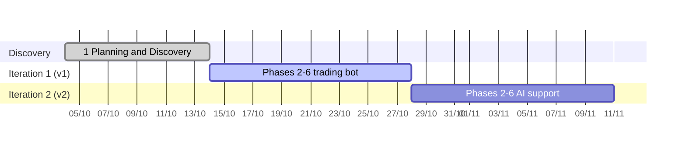

# Example: EA Bot trading with AI support (POC, Agile)

A proof of concept delivered with this playbook by one human and AI agent sessions: rebuild a grid trading bot for MetaTrader 5 whose source code is not available, improve it, then add AI support for the operator. The interesting part is phase 2: the requirements were recovered from the real trade history of the old bot, so every rule in the new spec is either confirmed by data or a deliberate, recorded change.

| Field | Value |
|---|---|
| Client | Internal (the human is the bot operator) |
| Product | Expert Advisor (EA) for MetaTrader 5: two independent DCA grids (buy and sell) on gold, entries by trailing stop orders, basket take-profit, fixed account stop-loss |
| Project type | POC run as **Agile** (the playbook's "longer than 2 weeks" mode): phase 1 once, then one iteration per version, each running phases 2–6 |
| Time box | v1 (the trading bot): 1–2 weeks · v2 (AI support): 1–2 weeks |
| Started | 04/10/2026 |
| Team | 1 human (operator, decides every gate) + 3 Claude Code sessions: Lead, Dev, Test (UI/UX and DevOps dropped: no server deployment, the only UI is a small button panel on the chart) |

## Timeline

| Stage | Phases | Dates | Gates | Status |
|---|---|---|---|---|
| Discovery | 1 Planning and Discovery | 04–14/10 | G1 Proposal locked 14/10 | Done |
| Iteration 1: v1 trading bot | 2 Requirements → 6 Deployment | 14/10 → by 28/10 | G2 and G3 locked 14/10; G4–G6 next; G6 = release to a social-trading master account (no real money at risk) | In progress (phase 4) |
| Iteration 2: v2 AI support | 2 Requirements → 6 Deployment | after iteration 1, by 11/11 | G2–G6 | Planned |
| Maintenance | 7 Maintenance | after iteration 1 | — | Forward test for 6–12 months |

Each iteration locks its own documents once; ideas raised inside an iteration go to the next iteration's backlog.

## 1. Planning and Discovery (proposal locked 14/10)

**Problem.** The operator runs a profitable grid bot on gold but has no source code: nothing can be fixed, tuned or made safer. The bot has no account-level stop-loss, no delay between grid orders and one fixed grid spacing, so the operator steps in by hand whenever the market trends.

**Input.** A business spec written by the operator before the project, a screenshot of the old bot's input parameters, and read access to the trade history of an account that runs the old bot (owned by a third party; its numbers stay private).

**Discovery method.** The AI read the spec, then asked the operator a fixed set of questions (purpose, capital, broker, profit target, maximum drawdown, hosting, manual intervention, go-live criteria, reference data) and a second round on the answers. It simulated the worst case (price moving one way through all grid levels) to show what each volume multiplier means for the drawdown limit, which moved the default from ×2 to ×1 and the growth factor towards 1.2.

**Options compared.**

| Option | What it is | Main risk |
|---|---|---|
| A | Clone the old bot exactly | Keeps its weakness in trends; no stop-loss |
| **B (chosen)** | Rebuild with the improvements in the operator's spec (spacing by grid level, entry offset, delay, two-stage trailing, fixed account stop-loss); AI only analyses and alerts in a later version | Default parameter values must come from backtests |
| C | Let AI decide trades | Cannot be verified by backtest; rejected |

**Locked scope.** v1 (iteration 1): the grid bot for gold, fixed stop-loss (amount or percent), manual control functions, news filter, trading hours. v2 (iteration 2): AI analysis and alerts (never placing trades), remote control over Telegram.

**Delivery mode.** The human chose Agile over Waterfall: two versions of 1–2 weeks each fit the playbook's "longer than 2 weeks" row, so phases 2–6 run once per version instead of once for the whole project.

**Success metric.** A backtest with a starting balance, a fixed stop-loss amount and a top-up rule written into the proposal: the account must never blow up, and the net profit after subtracting the starting balance and every top-up must reach the minimum monthly target. The period was first set from April 2025; phase 2 found that real tick data on the broker only starts in January 2026, so a change request (CR-01) moved the backtest to January 2026 and turned the profit bar into a monthly rate.

## 2. Requirements and Analysis (iteration 1, locked 14/10)

**Real data analysis: reverse-engineering the old bot.** The operator logged in to MetaTrader 5 with a read-only password on their own machine; the AI read the history through the terminal's Python API and never handled the password. Raw data stays on the local machine and out of git.

| Step | Result |
|---|---|
| Export | ~177,000 deals and ~184,000 orders over 15 months; symbol specification; M1 prices; ticks at each order time |
| Rebuild grid cycles | 3,096 cycles in the last two months: from the moment a side has no position to the moment the whole basket closes |
| Infer rules | Basket take-profit ≈ 20 pips from the volume-weighted average (median 20.6), whole basket closed in the same second by the EA itself; pending orders placed ≈ 20 pips from the market; no delay between orders; ~8% of entries added *with* the trend; volume formula recovered and matching 99.5% of 3,144 entries |
| Rule-by-rule comparison | Each rule of the operator's spec set against the old bot's behaviour, one decision per row |

**What the human decided.** Of eight rules where spec and data differed, the operator chose per row: keep the old bot's behaviour for initial orders and for restarting after take-profit; keep the improved spec for when grid orders are placed, grid spacing and trailing; postpone "adding with the trend" to the next-phase backlog. Each choice is a dated `DEC-NN` line on the board; the deviations of the old bot are kept as data findings, not as links to old documents.

**Course correction.** Midway, the operator stopped the deep analysis: describing the intended logic first and letting the AI verify it against the data was faster than inferring everything from the data. The analysis scripts stayed, so each later rule is checked in minutes.

**The core logic came out of a structured interview.** The operator described a full scenario (price falling while the bot holds buys) in ten short messages without interruption; the AI then asked one multiple-choice question at a time, each with a numeric example. This surfaced a mechanism the original spec did not have: a *hedging mode* entered when one side holds a set number of orders more than the other, in which the smaller side adds orders with the trend, both sides close together at a money target, and a persistent flag survives restarts. An *order-pruning* rule (close the deepest profitable order together with two losing ones when their sum is positive) came the same way, and was then checked against the old bot's partial closes.

**Data versus intent.** The history showed the old bot sized its take-profit by order count (about 2 per order) and closed hedged baskets at about 2. The operator kept volume-based take-profit and a larger hedging target on purpose; both are recorded as deliberate deviations, so a backtest difference is not mistaken for a bug.

**Risk review before locking.** The AI quantified the worst case: with the first grid spacing, a dense grid hit the account stop-loss after a move smaller than gold's median daily range. The operator answered with wider spacing for deep levels and four brakes, each an input parameter: a loss threshold that stops averaging down and switches to hedging (also a persistent flag), a pause after a stop-loss, no new cycles late on Friday, and a maximum spread. The worst-case move to the stop-loss grew by about a third.

**Locked output (G2).** PRD with 16 must-haves and 29 numbered business rules, each with a numeric example; 16 user stories with Given/When/Then criteria; data notes with 13 findings; 41 dated decisions and one approved change request on the board.

## 3. Design (iteration 1, locked 14/10)

**Questions first, then sections.** The AI asked six architecture questions one at a time (each with options, trade-offs and a recommendation), then presented the design in four sections for approval: modules and state machine; parameters, persistent state, log format and chart panel; broker errors and edge cases; testing and evaluation.

| Decision | Choice |
|---|---|
| ADR-0001 | Every trading decision is a pure function of a snapshot of the real orders taken on each tick; trade events are used only for logging |
| ADR-0002 | Three pieces of state that cannot be derived from orders (hedging flag, brake flag, last stop-loss time) are kept in terminal global variables |
| ADR-0003 | Live trading uses the platform's economic calendar; backtests run without the news filter (a worse case than live) |
| ADR-0004 | Pips, prices and money come from the symbol's specification, so the same code runs on other symbols and cent accounts |
| ADR-0005 | Closing a whole basket sets a persistent "closing" flag and keeps closing until nothing is left; opposite positions are closed against each other to save one spread per pair |
| ADR-0006 | Unit tests as a test EA inside the strategy tester; a rule checker reads the EA's log and checks every numbered business rule; scenarios run headless from config files |

**Design reviews caught two gaps in the locked PRD.** Releasing the risk brake by hand would have been undone on the next tick (the loss was still over the threshold), so the brake got a third state, *manual*, that holds until the basket closes. And nothing said what hedging does when one side is switched off. Both went through change requests (CR-02, CR-03) instead of silently editing the locked document.

**Contract between roles.** The log format (16 columns, 22 event types) is the interface between Dev and Test, so the Test session can build the rule checker in parallel with the code. The board lists Dev tasks D0–D8 and Test tasks T0–T5, each linked to stories and a done check.

## 4–7. Implementation to Maintenance (planned; iteration 2 repeats phases 2–6 for AI support)

| Phase | Plan |
|---|---|
| 4 Implementation | Dev session writes MQL5 against the spec; Test session builds a checker that reads the EA's log and the tester's trade history and checks each rule |
| 5 Testing | Scenario runs (range, strong trends, weekend gaps, stop-loss hit, restart, wrong inputs) must show zero rule violations; then the standard backtest against the success metric, with top-ups simulated inside the tester |
| 6 Deployment | Release v1 to the operator's social-trading master account (no real money at risk) |
| 7 Maintenance | Forward test for 6–12 months; case study; backlog for later iterations (adding with the trend) |

## AI and human split

| Phase | AI did | Human decided |
|---|---|---|
| Planning | Read the spec; asked structured discovery questions; simulated worst-case drawdown; proposed v1/v2 split | Purpose, capital, targets, stop-loss rule, backtest rule, scope; Agile with two 1–2 week iterations |
| Requirements | Exported and analysed the old bot's history; recovered its rules; interviewed one question at a time; quantified worst-case risk; wrote PRD and stories | Chose old or improved behaviour per rule; described hedging and pruning; set risk brakes; approved CR-01 and G2 |
| Design | Asked architecture questions with options; wrote spec, six ADRs, test strategy, eval plan, roles and tasks; found two gaps in the locked PRD | Chose each architecture option; approved CR-02, CR-03; cut the team to three roles; approved G3 |
| Process | First drafted a project-specific POC playbook, then replaced it with this playbook's phases, gates, board and kit | Required one shared process so the project could serve as an example |
