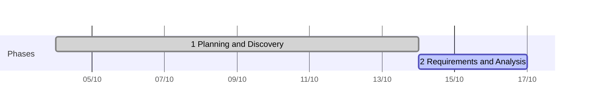

# Example: EA DCA Hedging (POC, rebuilding a black-box trading bot)

A proof of concept delivered with this playbook by one human and AI agent sessions: rebuild a grid trading bot for MetaTrader 5 whose source code is not available, then improve it. The interesting part is phase 2: the requirements were recovered from the real trade history of the old bot, so every rule in the new spec is either confirmed by data or a deliberate, recorded change.

| Field | Value |
|---|---|
| Client | Internal (the human is the bot operator) |
| Product | Expert Advisor (EA) for MetaTrader 5: two independent DCA grids (buy and sell) on gold, entries by trailing stop orders, basket take-profit, fixed account stop-loss |
| Project type | POC: prove the rebuilt bot follows its spec and meets a backtest target before building the full v1 |
| Started | 04/10/2026 |
| Team | 1 human (operator, decides every gate) + Claude Code sessions: Lead now; Dev and Test from phase 4 |

## Timeline

| # | Phase | Dates | Gate | Status |
|---|---|---|---|---|
| 1 | Planning and Discovery | 04–14/10 | G1 Proposal locked 14/10 (timeline and time box still open) | Done |
| 2 | Requirements and Analysis | From 14/10 | G2 Requirements locked | In progress |
| 3 | Design | — | G3 Design locked | Planned |
| 4 | Implementation | — | G4 Build complete | Planned |
| 5 | Testing | — | G5 Accepted | Planned |
| 6 | Deployment | — | G6 Released to a non-real-money account | Planned |
| 7 | Maintenance | — | — | Planned |

## 1. Planning and Discovery (proposal locked 14/10)

**Problem.** The operator runs a profitable grid bot on gold but has no source code: nothing can be fixed, tuned or made safer. The bot has no account-level stop-loss, no delay between grid orders and one fixed grid spacing, so the operator steps in by hand whenever the market trends.

**Input.** A business spec written by the operator before the project, a screenshot of the old bot's input parameters, and read access to the trade history of an account that runs the old bot (owned by a third party; its numbers stay private).

**Discovery method.** The AI read the spec, then asked the operator a fixed set of questions (purpose, capital, broker, profit target, maximum drawdown, hosting, manual intervention, go-live criteria, reference data) and a second round on the answers. It simulated the worst case (price moving one way through all grid levels) to show what each volume multiplier means for the drawdown limit, which moved the default from ×2 to ×1 and the growth factor towards 1.2.

**Options compared.**

| Option | What it is | Main risk |
|---|---|---|
| A | Clone the old bot exactly | Keeps its weakness in trends; no stop-loss |
| **B (chosen)** | Rebuild with the improvements in the operator's spec (spacing by grid level, entry offset, delay, two-stage trailing, fixed account stop-loss); AI only analyses and alerts in a later version | Default parameter values must come from backtests |
| C | Let AI decide trades | Cannot be verified by backtest; rejected |

**Locked scope.** v1: the grid bot for gold, fixed stop-loss (amount or percent), manual control functions, news filter, trading hours. v2 (next phase): AI analysis and alerts (never placing trades), remote control over Telegram.

**Success metric.** A backtest over the market regime the operator trusts (April 2025 to today) with a starting balance, a fixed stop-loss amount and a top-up rule written into the proposal: the account must never blow up, and the net profit after subtracting the starting balance and every top-up must exceed 100% of the starting balance.

## 2. Requirements and Analysis (in progress)

**Real data analysis: reverse-engineering the old bot.** The operator logged in to MetaTrader 5 with a read-only password on their own machine; the AI read the history through the terminal's Python API and never handled the password. Raw data stays on the local machine and out of git.

| Step | Result |
|---|---|
| Export | ~177,000 deals and ~184,000 orders over 15 months; symbol specification; M1 prices; ticks at each order time |
| Rebuild grid cycles | 3,096 cycles in the last two months: from the moment a side has no position to the moment the whole basket closes |
| Infer rules | Basket take-profit ≈ 20 pips from the volume-weighted average (median 20.6), whole basket closed in the same second by the EA itself; pending orders placed ≈ 20 pips from the market; no delay between orders; ~8% of entries added *with* the trend; volume formula recovered and matching 99.5% of 3,144 entries |
| Rule-by-rule comparison | Each rule of the operator's spec set against the old bot's behaviour, one decision per row |

**What the human decided.** Of eight rules where spec and data differed, the operator chose per row: keep the old bot's behaviour for initial orders and for restarting after take-profit; keep the improved spec for when grid orders are placed, grid spacing and trailing; postpone "adding with the trend" to the next-phase backlog. Each choice is a dated `DEC-NN` line on the board; the deviations of the old bot are kept as data findings, not as links to old documents.

**Course correction.** Midway, the operator stopped the deep analysis: describing the intended logic first and letting the AI verify it against the data was faster than inferring everything from the data. The analysis scripts stayed, so each later rule is checked in minutes.

## 3–7. Design to Maintenance (planned)

| Phase | Plan |
|---|---|
| 3 Design | Spec with numbered, testable rules; module and state-machine design of the EA; ADRs; every number an input parameter (no hard-coded symbol, pip or contract size); a fixed log format for every trading decision |
| 4 Implementation | Dev session writes MQL5 against the spec; Test session builds a checker that reads the EA's log and the tester's trade history and checks each rule |
| 5 Testing | Scenario runs (range, strong trends, weekend gaps, stop-loss hit, restart, wrong inputs) must show zero rule violations; then the standard backtest against the success metric, with top-ups simulated inside the tester |
| 6 Deployment | Release to the operator's social-trading master account (no real money at risk), followed for 6–12 months |
| 7 Maintenance | Case study; v2 backlog (AI alerts, Telegram control, adding with the trend) |

## AI and human split

| Phase | AI did | Human decided |
|---|---|---|
| Planning | Read the spec; asked structured discovery questions; simulated worst-case drawdown; proposed v1/v2 split | Purpose, capital, targets, stop-loss rule, backtest rule, scope |
| Requirements | Exported and analysed the old bot's history; recovered its rules; built a rule-by-rule comparison | Chose old or improved behaviour per rule; cut the deep analysis; postponed one feature |
| Process | First drafted a project-specific POC playbook, then replaced it with this playbook's phases, gates, board and kit | Required one shared process so the project could serve as an example |
