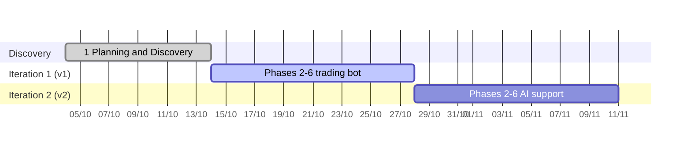

# Example: EA Bot trading with AI support (POC, Agile)

A proof of concept delivered with this playbook by one human and AI agent sessions: rebuild a grid trading bot for MetaTrader 5 whose source code is not available, improve it, then add AI support for the operator. The interesting part is phase 2: the requirements were recovered from the real trade history of the old bot, so every rule in the new spec is either confirmed by data or a deliberate, recorded change.

| Field | Value |
|---|---|
| Client | Internal (the human is the bot operator) |
| Product | Expert Advisor (EA) for MetaTrader 5: two independent DCA grids (buy and sell) on gold, entries by trailing stop orders, basket take-profit, fixed account stop-loss |
| Project type | POC run as **Agile** (the playbook's "longer than 2 weeks" mode): phase 1 once, then one iteration per version, each running phases 2–6 |
| Time box | v1 (the trading bot): 1–2 weeks · v2 (AI support): 1–2 weeks |
| Started | 04/10/2026 |
| Team | 1 human (operator, decides every gate) + 3 Claude Code sessions: Lead, Dev, Test (UI/UX and DevOps dropped: no server deployment, the only UI is a small button panel on the chart) |

## Timeline

| Stage | Phases | Dates | Gates | Status |
|---|---|---|---|---|
| Discovery | 1 Planning and Discovery | 04–14/10 | G1 Proposal locked 14/10 | Done |
| Iteration 1: v1 trading bot | 2 Requirements → 6 Deployment | 14/10 → by 28/10 | G2 and G3 locked 14/10; G4–G6 next; G6 = release to a social-trading master account (no real money at risk) | In progress (phase 4) |
| Iteration 2: v2 AI support | 2 Requirements → 6 Deployment | after iteration 1, by 11/11 | G2–G6 | Planned |
| Maintenance | 7 Maintenance | after iteration 1 | — | Forward test for 6–12 months |

Each iteration locks its own documents once; ideas raised inside an iteration go to the next iteration's backlog.

## 1. Planning and Discovery (proposal locked 14/10)

**Problem.** The operator runs a profitable grid bot on gold but has no source code: nothing can be fixed, tuned or made safer. The bot has no account-level stop-loss, no delay between grid orders and one fixed grid spacing, so the operator steps in by hand whenever the market trends.

**Input.** A business spec written by the operator before the project, a screenshot of the old bot's input parameters, and read access to the trade history of an account that runs the old bot (owned by a third party; its numbers stay private).

**Discovery method.** The AI read the spec, then asked the operator a fixed set of questions (purpose, capital, broker, profit target, maximum drawdown, hosting, manual intervention, go-live criteria, reference data) and a second round on the answers. It simulated the worst case (price moving one way through all grid levels) to show what each volume multiplier means for the drawdown limit, which moved the default from ×2 to ×1 and the growth factor towards 1.2.

**Options compared.**

| Option | What it is | Main risk |
|---|---|---|
| A | Clone the old bot exactly | Keeps its weakness in trends; no stop-loss |
| **B (chosen)** | Rebuild with the improvements in the operator's spec (spacing by grid level, entry offset, delay, two-stage trailing, fixed account stop-loss); AI only analyses and alerts in a later version | Default parameter values must come from backtests |
| C | Let AI decide trades | Cannot be verified by backtest; rejected |

**Locked scope.** v1 (iteration 1): the grid bot for gold, fixed stop-loss (amount or percent), manual control functions, news filter, trading hours. v2 (iteration 2): AI analysis and alerts (never placing trades), remote control over Telegram.

**Delivery mode.** The human chose Agile over Waterfall: two versions of 1–2 weeks each fit the playbook's "longer than 2 weeks" row, so phases 2–6 run once per version instead of once for the whole project.

**Success metric.** A backtest with a starting balance, a fixed stop-loss amount and a top-up rule written into the proposal: the account must never blow up, and the net profit after subtracting the starting balance and every top-up must reach the minimum monthly target. The period was first set from April 2025; phase 2 found that real tick data on the broker only starts in January 2026, so a change request (CR-01) moved the backtest to January 2026 and turned the profit bar into a monthly rate.

## 2. Requirements and Analysis (iteration 1, locked 14/10)

**Real data analysis: reverse-engineering the old bot.** The operator logged in to MetaTrader 5 with a read-only password on their own machine; the AI read the history through the terminal's Python API and never handled the password. Raw data stays on the local machine and out of git.

| Step | Result |
|---|---|
| Export | ~177,000 deals and ~184,000 orders over 15 months; symbol specification; M1 prices; ticks at each order time |
| Rebuild grid cycles | 3,096 cycles in the last two months: from the moment a side has no position to the moment the whole basket closes |
| Infer rules | Basket take-profit ≈ 20 pips from the volume-weighted average (median 20.6), whole basket closed in the same second by the EA itself; pending orders placed ≈ 20 pips from the market; no delay between orders; ~8% of entries added *with* the trend; volume formula recovered and matching 99.5% of 3,144 entries |
| Rule-by-rule comparison | Each rule of the operator's spec set against the old bot's behaviour, one decision per row |

**What the human decided.** Of eight rules where spec and data differed, the operator chose per row: keep the old bot's behaviour for initial orders and for restarting after take-profit; keep the improved spec for when grid orders are placed, grid spacing and trailing; postpone "adding with the trend" to the next-phase backlog. Each choice is a dated `DEC-NN` line on the board; the deviations of the old bot are kept as data findings, not as links to old documents.

**Course correction.** Midway, the operator stopped the deep analysis: describing the intended logic first and letting the AI verify it against the data was faster than inferring everything from the data. The analysis scripts stayed, so each later rule is checked in minutes.

**The core logic came out of a structured interview.** The operator described a full scenario (price falling while the bot holds buys) in ten short messages without interruption; the AI then asked one multiple-choice question at a time, each with a numeric example. This surfaced a mechanism the original spec did not have: a *hedging mode* entered when one side holds a set number of orders more than the other, in which the smaller side adds orders with the trend, both sides close together at a money target, and a persistent flag survives restarts. An *order-pruning* rule (close the deepest profitable order together with two losing ones when their sum is positive) came the same way, and was then checked against the old bot's partial closes.

**Data versus intent.** The history showed the old bot sized its take-profit by order count (about 2 per order) and closed hedged baskets at about 2. The operator kept volume-based take-profit and a larger hedging target on purpose; both are recorded as deliberate deviations, so a backtest difference is not mistaken for a bug.

**Risk review before locking.** The AI quantified the worst case: with the first grid spacing, a dense grid hit the account stop-loss after a move smaller than gold's median daily range. The operator answered with wider spacing for deep levels and four brakes, each an input parameter: a loss threshold that stops averaging down and switches to hedging (also a persistent flag), a pause after a stop-loss, no new cycles late on Friday, and a maximum spread. The worst-case move to the stop-loss grew by about a third.

**Locked output (G2).** PRD with 16 must-haves and 29 numbered business rules, each with a numeric example; 16 user stories with Given/When/Then criteria; data notes with 13 findings; 41 dated decisions and one approved change request on the board.

## 3. Design (iteration 1, locked 14/10)

**Questions first, then sections.** The AI asked six architecture questions one at a time (each with options, trade-offs and a recommendation), then presented the design in four sections for approval: modules and state machine; parameters, persistent state, log format and chart panel; broker errors and edge cases; testing and evaluation.

| Decision | Choice |
|---|---|
| ADR-0001 | Every trading decision is a pure function of a snapshot of the real orders taken on each tick; trade events are used only for logging |
| ADR-0002 | Three pieces of state that cannot be derived from orders (hedging flag, brake flag, last stop-loss time) are kept in terminal global variables |
| ADR-0003 | Live trading uses the platform's economic calendar; backtests run without the news filter (a worse case than live) |
| ADR-0004 | Pips, prices and money come from the symbol's specification, so the same code runs on other symbols and cent accounts |
| ADR-0005 | Closing a whole basket sets a persistent "closing" flag and keeps closing until nothing is left; opposite positions are closed against each other to save one spread per pair |
| ADR-0006 | Unit tests as a test EA inside the strategy tester; a rule checker reads the EA's log and checks every numbered business rule; scenarios run headless from config files |

**Design reviews caught two gaps in the locked PRD.** Releasing the risk brake by hand would have been undone on the next tick (the loss was still over the threshold), so the brake got a third state, *manual*, that holds until the basket closes. And nothing said what hedging does when one side is switched off. Both went through change requests (CR-02, CR-03) instead of silently editing the locked document.

**Contract between roles.** The log format (16 columns, 22 event types) is the interface between Dev and Test, so the Test session can build the rule checker in parallel with the code. The board lists Dev tasks D0–D8 and Test tasks T0–T5, each linked to stories and a done check.

## 4. Implementation (iteration 1, in progress)

**Plans first, reviewed by the Lead.** The Dev session wrote its plan (module order, unit tests written before each module, a pure-function core so rules are testable) and the Test session wrote its plan (25 rule checks read from the EA's log, eight tester scenarios, a manual checklist for what the tester cannot do). The Lead checked both against the spec, asked for missing tests, and turned their questions into two small change requests (CR-04, CR-05) instead of letting either session reinterpret the spec.

**Test environment without real money or shared passwords.** Rule tests run on a demo account at a second broker in a separate MetaTrader 5 copy; the evaluation backtest stays on the target broker's data. When the human pasted a demo password into the chat, the AI did not use or store it and asked for it to be changed; the human logged in themselves. The second broker's gold symbol has three decimals instead of two, which became a free test that nothing in the code assumes gold's contract details.

**A spec review that stopped the coding.** Before the first line of code, the human paused the Dev session (a hold on the board) to read the approved spec once more. One question at a time, the review produced 25 changes in a single change request (CR-06): trader-friendly parameter names, take-profit placed on the broker's server when one basket is open (to cut slippage) while the EA closes a hedged basket itself, a two-rule pruning scheme, a clearer hedging entry and exit, daily and manual take-profit / stop-loss, and a status panel. Working the rules through with numeric examples exposed several conflicts before they became bugs: a minimum-gap rule that blocked the very pruning meant to exit hedging, a hedging state that could not be derived from open orders alone, server-side stop-losses that would close the two sides at different prices because of the spread, and pending orders that could still fill after a side was switched off. The spec was rewritten, a seventh ADR recorded the take-profit decision, and four new user stories were added before the hold was lifted.

**Sessions do not watch the board.** Role sessions only work when someone writes to them, so hand-offs posted on the board sat unread for hours. The Lead now relays each hand-off with a short cross-session message (with the human's agreement), and the board stays the record. The first relay paid off at once: the Dev session pointed out that one of the Lead's own hand-offs still described a rule that the spec review had removed, and wrote its tests against the spec instead of the stale note. Relays are not instant either: a session that works continuously only reads new messages between its turns, so answers sometimes arrived after the question had been asked again. Every answer therefore goes on the board first, and later relays point to the board rows instead of repeating them.

**Risk assessment while the code is being written.** With Dev and Test busy, the human asked for an honest view of the strategy's capability and risk. The AI ran a time-boxed spike: a worst-case calculation with the final parameters, the old bot's monthly returns from its real history, and a deliberately rough simulation on 2026 five-minute bars (no hedging, no pruning, no swap; throwaway code kept out of the repo). Findings: the default settings cleared the profit bar (about 10% a month) but hit the account stop-loss roughly once a month; the risk brake cut losses noticeably; a higher Martingale factor failed the bar; without a stop-loss the account would have been wiped out. The old bot's history added the decisive context: it survived 2026 with three to six times the planned capital and no stop-loss, and the one time it ran with the planned capital it was stopped out on day two. The findings went into the PRD risk table with evidence and into the eval plan as new measures (stop-losses per month, stop-loss streaks within 30 days, total swap), through a change request rather than a silent edit.

**The Lead re-runs everything before approving a task.** Each finished Dev task is reviewed by the Lead, who does not take the Dev session's word for it: it rebuilds the EA for both brokers, reruns the unit tests (191 after the first two tasks, every money calculation checked against both gold symbols) and compares the inputs one by one with the spec. The first review found a small defect the Dev session had missed (build scripts crashed when printing Vietnamese on a non-UTF-8 console); the second confirmed the fix. When the Dev session had to choose something the spec left open (how to round a lot size, how to project a price from a profit target), it stopped and asked; the Lead answered and logged each answer as a decision, so the choice is visible to Test and to later iterations.

**Real broker data catches a spec that reads well.** The spec said the trading day starts at "the first trading session of the day". Reading the actual session table of the test broker, the Dev session found that the broker splits one gold session at midnight, so a literal reading put the day boundary two hours later than the spec's own example. Instead of picking an interpretation, it asked, with a proposal: start the day where trading resumes after the longest break. The Lead tightened the edge cases (sessions joined across midnight, days with no restart, brokers with no session table) and the human approved it as a small change request (CR-10) the same hour; the Dev session kept working on the parts of the module that did not depend on the answer.

**Two sessions, one test terminal.** Dev and Test shared a single MetaTrader 5 copy for testing. The Dev session noticed that rebuilding the EA in the middle of Test's scenario batch would silently mix two versions in one result. The fix was cheap: an atomic lock file that every build, unit-test and scenario script takes for the whole batch, plus the EA's hash in every report. The hash then turned out to change on every compile and per terminal, so builds are now identified by a hash of the source tree written to a small build manifest.

**Code done, reviewed task by task.** The Dev session wrote the EA in 17 small modules, each test-first (close to 1,000 unit tests run on both brokers' gold symbols), and moved on as soon as one was in review; the Lead reviewed in parallel, rerunning the tests and reading the code against the spec, sometimes with a review subagent. Reviews caught real defects before any scenario ran: "most profitable order" chosen by best price instead of money (the Test session's checker had the same mistake, so neither would have caught it), and a close-all routine with no fallback when the broker refuses close-by orders, which the evaluation broker indeed does not allow. Each question the spec left open became either a logged decision or, when it changed a locked document, a small change request approved by the human: fifteen in this phase, most of them one line.

**Running the evaluation early changed the conversation.** With the scenarios passing, the human agreed to run the full-period evaluation backtest before the code was finished, on the target broker. It failed hard: a strong gold trend in January 2026 produced a chain of stop-losses and the account was wiped out within weeks, even with the allowed top-ups. The first run also showed thousands of rule violations and broker rejections. Rather than trust either number, the Lead asked for a diagnostic rerun without simulated execution delay: zero violations and zero rejections, but the same wipe-out. So the violations came from the log recording prices after a delayed order instead of the prices the EA decided on (fixed by a change request to the log contract), while the loss was the strategy itself, as the earlier risk spike had warned. The human then chose a parameter sensitivity spike (capital, Martingale, grid spacing, order cap, hedging on or off) before deciding how to change the strategy, two weeks before the iteration's deadline instead of at the final gate.

**Spikes answer a narrower question than you hope.** The sensitivity spikes (each a full nine-month tick backtest, 20 to 50 minutes of machine time) gave a clear negative: no parameter set reached the bar. They also produced one useful number: lowering the stop-loss only split the same monthly loss into more, smaller hits, while the money the grid earned between losses stayed at about 80% of what the stop-losses took. That pointed at the strategy's structure rather than its settings. A rerun on the previous year gave the same sign, so the result was not an artefact of one period. One false alarm is worth recording: a tester run that "hung" was still running; its logs were simply buffered. The terminal's own progress line is now the only signal used for that.

**The human took the steering wheel.** After two rounds of AI-designed spikes, the human said they would choose every parameter set themselves and that nothing strategic should run without them; a little later, that approved changes should not go to Dev and Test until they said so. Both became standing rules on the board and in the AI's memory. The redesign then happened in conversation, one rule at a time, with the AI checking each idea against the code, the spec and worked numbers: hedging defined by the volume difference between the two sides instead of the order count (thresholds chosen from the actual lot ladder), a run-mode switch (both sides / buy only / sell only) for the operator, take-profit and stop-loss placed on the broker in every state so the basket closes even if the server dies (the larger side set to fill first, the smaller one offset by a spread buffer), a spread limit the EA measures itself, and simpler pruning rules. Twice the AI's restatement of the human's rule was wrong; writing each rule back as a small worked example caught both. The result was one change request (CR-16) with five parts and a new ADR replacing an earlier one; Dev and Test then raised a dozen precise questions about it, each answered as a one-line decision.

**A short technical run tunes the design, not just the code.** The Dev session finished all of CR-16 in under a day, test-first (about 1,150 unit tests). Its first two-week check on the target broker was clean, but it surfaced a design cost nobody had priced: tying the spread buffer to the live spread made the EA re-send its broker-side TP/SL more than 200 times in two weeks. The human switched the buffer to the EA's own 24-hour median spread, a one-line change to the spec. The Test session's checker, run on the same log, first reported 34 issues; 32 were its own misreadings of the new broker-closed events, fixed test-first, and the remaining two were a real ordering slip in the EA, logged in a defect register that the Dev session works from.

**Short technical runs find what unit tests cannot.** After CR-16 the Lead stopped asking for full-period backtests and instead specified short, targeted runs on the tester: a week with the stop-loss lowered to 150 so it fires several times, a fortnight of strong trend with thresholds lowered so pruning and the new order-count guard are exercised. Each run took a minute or two, and the Test session's log checker turned it into a list of rule violations. That loop found a dozen real defects in a day (a pending order that filled during the cool-down after a stop-loss, a position left without TP or SL for 39 seconds, a basket closed at a loss because the broker still held its previous take-profit level) and just as many checker misreadings, each fixed test-first and recorded in a defect register that the Dev session works from.

**Know what the simulator is simulating.** Two findings were about the tester rather than the bot. Sending TP/SL changes asynchronously (ADR-0009) removed the "blind" seconds in which the EA could not see new ticks, but the tester still applies each asynchronous request one after another with its own random delay, so some race conditions only exist in simulation. And the random execution delay the evaluation plan had chosen was several seconds per order, far slower than the real broker. With numbers in hand (three losing basket closes under random delay, none under a fixed 200 ms delay on the same fortnight), the human moved the evaluation to a fixed 200 ms delay and deferred the deeper fix to the next iteration's backlog rather than spend days on a case that barely occurs live.

**Many small backtests before one big one.** A full nine-month evaluation run took hours, so the human stopped it and asked for seven six-week runs instead, each with a different stop-loss and daily limit chosen by the human. None reached the profit bar and none blew up the account; the results showed a clear middle ground for the stop-loss (very tight stops fired too often, very wide ones lost too much each time), which is the kind of signal a single long run would have taken an afternoon to give. Housekeeping happened along the way: the project moved to its own private repository, and renaming the folder silently cut the Dev and Test sessions off from messages until they were reopened in the new path, a reminder that sessions are bound to a folder.

**From the simulator to a live demo account.** A full nine-month run with a wide stop-loss lost heavily (fourteen stop-losses of about the same size), while the six-week runs had pointed to a middle ground, so the human decided to watch the bot on a live demo account before tuning further. The Lead built the current version into the demo terminal with a preset of the default parameters, and held the shared terminal lock for the whole forward test so neither the Dev nor the Test session could rebuild or start a backtest on top of the running EA. The EA's own log from the demo becomes the first real-market input for the Test session's rule checker. Two operational lessons came with the long runs: a Windows Update restart killed an overnight backtest, and a retry loop in a helper script kept restarting runs after the human had asked to stop, so the Test session now launches runs directly and the human pauses updates during long runs.

**What two hours on a live demo found.** The demo matched the spec for everything the EA did on its own, but it exposed three things the simulator never could. A Friday "no new cycles" rule blocked the first order on the empty side of a hedged block, leaving it one-sided into the weekend. The operator's buttons were invisible in the log, so the rule checker flagged forty correct trades as violations. And the "remove TP/SL" button looked broken: a retry mechanism added earlier to re-send rejected TP/SL changes saw the removed levels as missing and put them back within three seconds. The last one was found by reading the EA's own log against the button presses, not by guessing.

**From one defect to a design conversation.** Each finding opened a short discussion with the human, and most ended as a new parameter rather than a fixed rule. The human's standing preference became explicit: a new behaviour gets a switch, so a bad backtest can be undone without touching code. The session produced eleven change requests in an afternoon: a TP/SL mode the operator controls (automatic, manual with levels, or removed until reset); a regrouped control panel with the bot's state in each group title and a "halt until tomorrow" button; a risk schedule by hour of day, kept in a text file the EA reloads, with three levels that decide whether the bot exits early and whether it may start new cycles; news windows treated as the highest level; switches for adding with the trend, for letting the hedged side keep averaging, for pruning in two-way mode, for closing early when one side grows large, and for computing take-profit by order count instead of volume. The AI's part was to restate each rule as a worked example (several were corrected that way), to check every idea against the code before writing it down (the take-profit target, for one, was already computed in two functions, which halved the estimate), and to collect the decisions as numbered entries on the board. Dev and Test worked from the change-request files while the spec caught up, and asked their questions through the Lead; both answered with tests first.

## 5–7. Testing to Maintenance (planned; iteration 2 repeats phases 2–6 for AI support)

| Phase | Plan |
|---|---|
| 5 Testing | Scenario runs (range, strong trends, weekend gaps, stop-loss hit, restart, wrong inputs) must show zero rule violations; then the standard backtest against the success metric, with top-ups simulated inside the tester |
| 6 Deployment | Release v1 to the operator's social-trading master account (no real money at risk) |
| 7 Maintenance | Forward test for 6–12 months; case study; backlog for later iterations (adding with the trend) |

## AI and human split

| Phase | AI did | Human decided |
|---|---|---|
| Planning | Read the spec; asked structured discovery questions; simulated worst-case drawdown; proposed v1/v2 split | Purpose, capital, targets, stop-loss rule, backtest rule, scope; Agile with two 1–2 week iterations |
| Requirements | Exported and analysed the old bot's history; recovered its rules; interviewed one question at a time; quantified worst-case risk; wrote PRD and stories | Chose old or improved behaviour per rule; described hedging and pruning; set risk brakes; approved CR-01 and G2 |
| Design | Asked architecture questions with options; wrote spec, six ADRs, test strategy, eval plan, roles and tasks; found two gaps in the locked PRD | Chose each architecture option; approved CR-02, CR-03; cut the team to three roles; approved G3 |
| Implementation (so far) | Reviewed the Dev and Test plans; set up an isolated test terminal; turned a spec review into one change request with conflicts resolved; rewrote the spec and stories; relayed hand-offs to the role sessions; ran a risk spike; re-ran builds and tests before approving each Dev task; specified short technical runs; ran the defect register with Dev and Test; set up a shared-terminal lock and build identity; diagnosed the early evaluation run; ran two spike rounds and wrote the strategy redesign up as CR-16 with a new ADR; ran the live demo build and lock; read the demo log against the button presses; turned the post-demo discussion into CR-17 and CR-22 to CR-32 with the spec updated in one revision | Paused coding to review the spec; decided 25 changes one question at a time; approved CR-04 to CR-15; chose to run the evaluation early and then sensitivity spikes; took over parameter choice and hand-off timing; redesigned hedging, run modes and preset TP/SL in CR-16; decided the remaining edge cases; ran the demo and pressed the buttons; designed the risk schedule, panel layout and new exit options, each behind a parameter |
| Process | First drafted a project-specific POC playbook, then replaced it with this playbook's phases, gates, board and kit | Required one shared process so the project could serve as an example |
