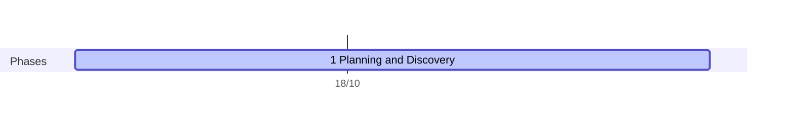

# Example: AI CMS frontend (news site modernization)

A real client project delivered with this playbook: rebuild the reader-facing front end of a news website whose current site runs on a legacy CMS. The client's name and data stay private; this page is the delivery record, updated at each gate.

| Field | Value |
|---|---|
| Client | The client (a Vietnamese online newspaper) |
| Product | New reader-facing website (home, sections, article pages, search, mobile) that reads the content the newsroom already publishes in its current CMS |
| Project type | Modernization, read side first: the editors keep their current CMS; the new front end runs alongside the old site until the client switches over |
| Started | 15/10/2026 |
| Team | 1 human (solution lead) + Claude Code sessions: Lead now; UI/UX from phase 3; Dev, DevOps and Test from phase 4 |

## Timeline

| # | Phase | Dates | Gate | Status |
|---|---|---|---|---|
| 1 | Planning and Discovery | From 15/10 | G1 Proposal locked | In progress |
| 2 | Requirements and Analysis | — | G2 Requirements locked | Planned |
| 3 | Design | — | G3 Design locked | Planned |
| 4 | Implementation | — | G4 Build complete | Planned |
| 5 | Testing | — | G5 Accepted | Planned |
| 6 | Deployment | — | G6 Released (beta, then switch-over) | Planned |
| 7 | Maintenance | — | — | Planned |

Dates for phases 2–7 are set when G1 locks.

## 1. Planning and Discovery (in progress)

**Problem.** The current site runs on a legacy CMS that is slow for readers, especially on mobile, and costly to maintain and change. The client has not yet agreed to replace the CMS, so the project starts where the risk is lowest and the gain is most visible: the pages readers see.

**Approach under discussion (strangler fig, read side first).** Build the new front end on a read-only copy of the CMS data. The CMS keeps writing; the new site only reads. It runs side by side with the old site, so the client can compare them and switch back at any time. Replacing the CMS itself (editing, workflow, media) is a later project, only after a contract.

**Known constraints.**
- Read-only access to a copy of the content database; no load on the live database.
- The client's servers run Windows, so the hosting choice must fit their operations team.
- URLs and SEO must survive the move: old URLs keep working through permanent redirects.

**Phase 1 work (Lead):** baseline measurements of the current site (public page-speed and Core Web Vitals, page weight), options with effort and risk, proposal draft, repo setup. G1 locks scope, time box and dates.

## 2–7. Planned

- **Requirements:** PRD with must-haves per page type, success metrics against the phase 1 baseline, real data analysis on a local copy of the database (never in git or the cloud).
- **Design:** UI design and prototype; spec; ADRs (framework and runtime, data access, caching, URL and redirect handling, hosting); test strategy.
- **Implementation, Testing, Deployment:** per [process.md](../process.md) and [agent-team.md](../agent-team.md); beta on a separate address first, measured before and after.

## AI and human split

| Phase | AI did | Human decided |
|---|---|---|
| Planning | (in progress) | Project set up as a new repo and a Lead session (15/10) |
