# Worked example: Habit Tracker

**Purpose:** show one real run of the playbook at Starter level, from an empty folder to two released versions, with what the owner typed, what the sessions did, and what went wrong.

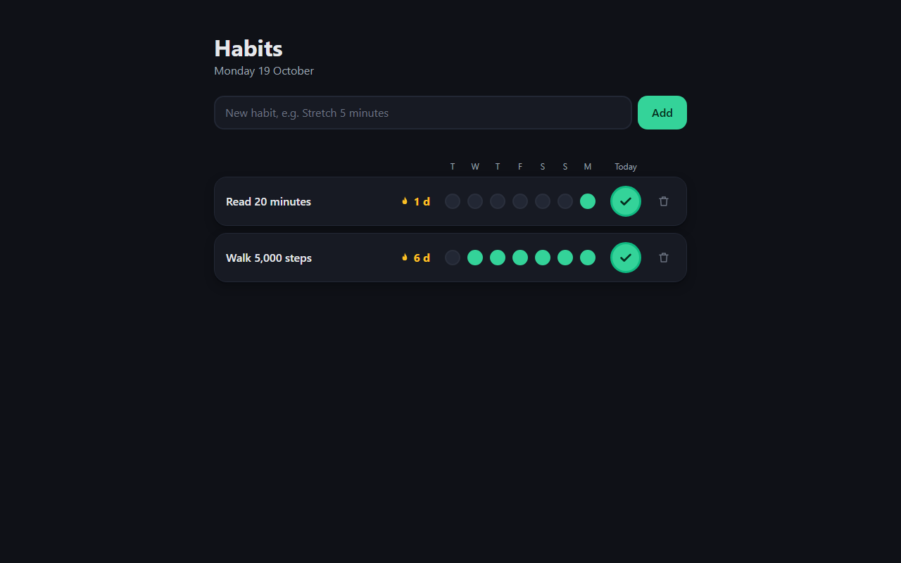

| | |
|---|---|
| Product | A one-page habit tracker for one person: add habits, tick them off each day, see the streak and the last 7 days |
| Level | Starter: one Claude Code session plays PO, Lead and Dev |
| Repo | [liquizzz/habit-tracker](https://github.com/liquizzz/habit-tracker) (public): issues, commits, releases and images are all there |
| Stack (chosen by the owner) | Node 24 with its built-in SQLite, Express, one plain HTML/CSS/JS page, Vitest, ESLint, Docker. One runtime dependency |
| Result | v0.1.0 and v0.2.0 released, each a tagged Docker image on `ghcr.io`; v0.2.0 with an SBOM and a verified build attestation |
| Time | About 1 h 40 min from `init` to v0.2.0, owner testing included |
| Sessions | One Lead session up to v0.1.0, then a fresh Lead session for v0.2.0 |

The run used the playbook as it was on 2026-10-19 (commit `5048793`). Problems it found are listed at the end, with the fixes planned for the kit.

## The run, step by step

| # | Owner typed | Time | What happened |
|---|---|---|---|
| 0 | `git clone` the playbook | 1 min | Tools were already installed (Git, Node, Docker, `gh` with the `project` scope, the plugins) |
| 1 | `node ai-delivery-playbook/kit/init.mjs` | 2 min | Eight questions; the repo, branches, labels, board, CI, Dependabot, secret scanning and the Lead worktree were created |
| 2 | `/setup` | 23 min | Questions in rounds, three stack options, ADR-001, Docker and CI fitted to the stack, CI green on `dev` |
| 3 | `/brief <idea>` | 22 min | Questions in rounds, a look-and-feel page with three directions, the brief, a one-page SRS and four task issues; the owner changed the look once, then approved |
| 4 | `/build` | 9 min | Four tasks, each committed with its issue number, merged into `dev` and closed only after CI on `dev` was green |
| 5 | `/release` | 13 min | Five acceptance scenarios for the owner, release notes, tag `v0.1.0`, image on `ghcr.io` |
| 6 | Two commands from `START-HERE.md` | 2 min | v0.1.0 ran from the published image, with no login (public package) |
| 7 | New session, then a defect, `/change`, `/build`, `/release` | 21 min | v0.2.0: tick any of the last 7 days, the narrow-window fix and the image build fix |

### 1. Create the project

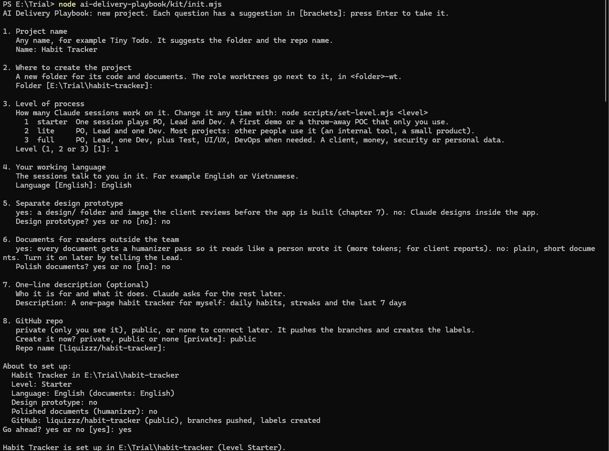

The idea, typed later in step 3: "A one-page habit tracker for myself. I add a few daily habits, tick them off each day, and see my current streak and the last 7 days for each one. It runs in Docker on my machine and keeps my data across restarts."

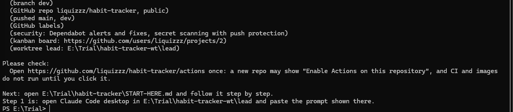

The owner then opened the repo's Actions tab once and clicked "Enable Actions", and made the board public.

### 2. Setup: the owner picks the stack

The session opened the `superpowers:brainstorming` skill and asked one topic per round. The stack got its own round, with three options from the lightest to the fullest.

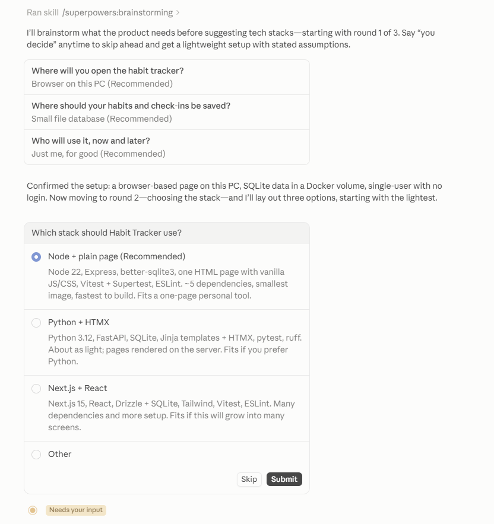

The first choice, `better-sqlite3`, needed a C++ compiler on Windows, so a clean install failed. The session stopped, asked the owner, switched to the SQLite module built into Node 24 and recorded the switch and the rejected options in ADR-001. It then pushed to `dev` and checked the live CI runs before reporting.

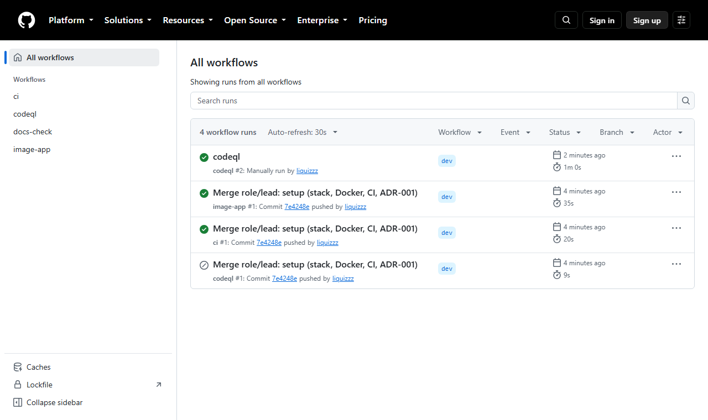

### 3. Brief: one approval for G1-G3

After the interview, `ui-ux-pro-max` searched styles, palettes and fonts for a personal habit tracker, and the session showed three directions on one page.

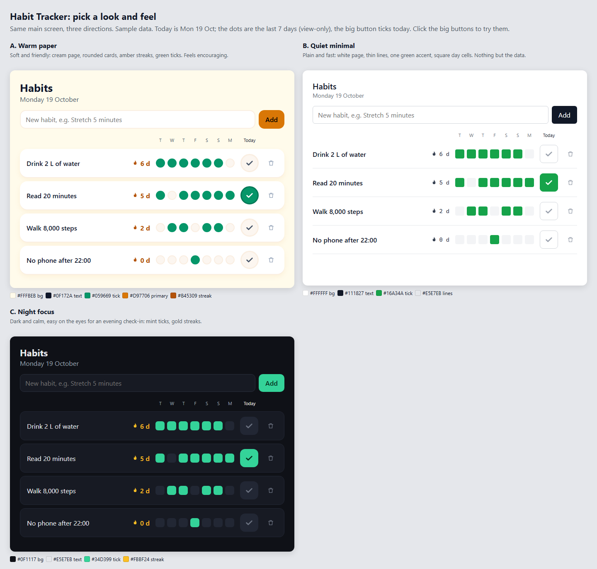

Before asking for approval it checked the Starter gate against the repo and GitHub, criterion by criterion, and marked "Brief approved" as waiting for the owner.

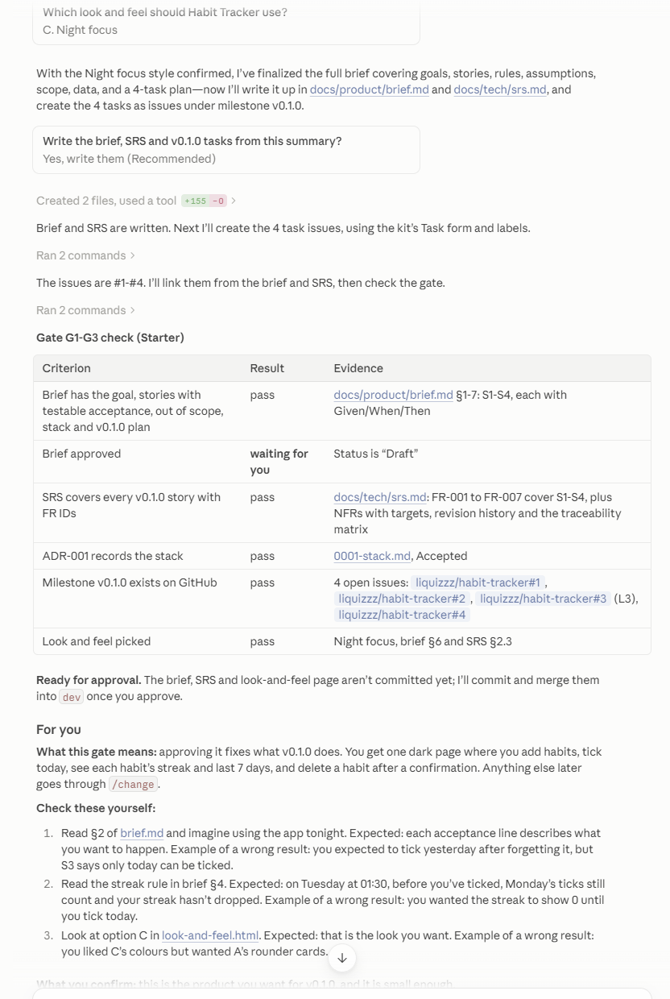

The `For you` block told the owner what to read or try, with the expected result and an example of a wrong one. The owner chose "Change something" and asked for a mix: the dark colours of C with the rounded cards and dots of A. The session added that as option D, updated the brief, the SRS and the issue, and asked again.

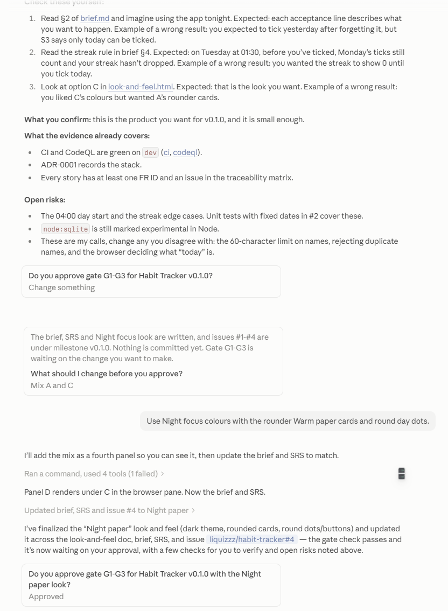

Product decisions recorded in the brief: a day starts at 04:00; the streak counts up to yesterday until today is ticked; only today can be ticked in v0.1.0; deleting a habit removes its history after a confirmation (an L3 change).

### 4. Build

Four issues: add and list (L2), tick and streak (L2), delete (L3), the main screen (L2). Each was built on `role/lead` with tests for its level, merged into `dev`, and closed after its CI run on `dev` passed. The main screen was built with the `frontend-design` skill in the approved look.

### 5. Release v0.1.0

The session gave five acceptance scenarios, each with steps, the expected result and an example of a wrong result, plus the PowerShell commands to start `dev` in Docker. The owner tried them and approved. The session asked once more before it pushed `main` and the tag.

The image built and was pushed, but the release run failed: the kit's SBOM step tried to attach the SBOM to the GitHub release without permission, which also skipped the attestation. The session found the cause, checked that the image was in the registry, and asked how to handle it. The owner kept v0.1.0 as it was, and the fix went into the next version.

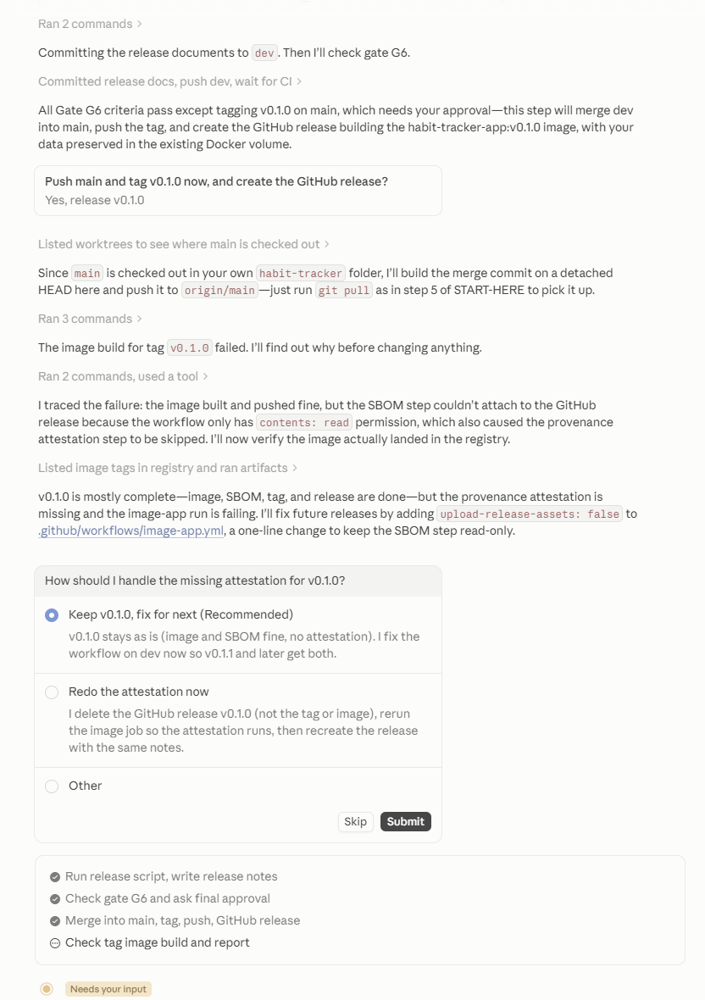

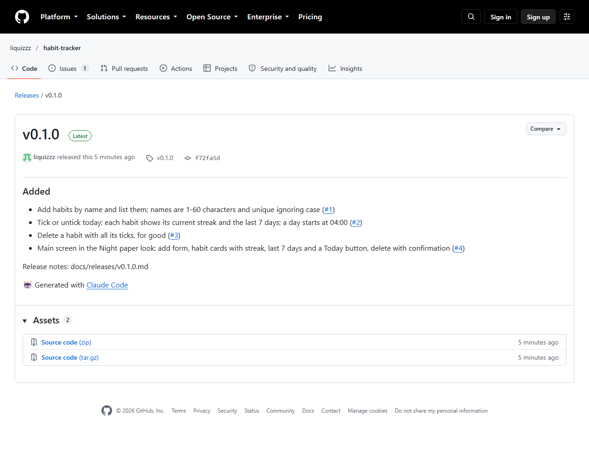

### 6. Run the release from its image

```
$env:IMAGE_TAG="v0.1.0"; docker compose up --no-build -d app
```

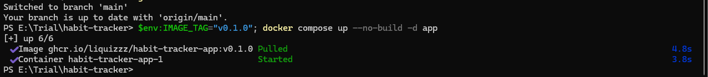

### 7. A fresh session picks up from the record

The owner closed the session and opened a new one in the same folder. Before anything else, it ran `/status` and rebuilt the state from git and GitHub alone: what was released, which issue was still open, CI on `dev`, and the next step. It also noticed that the Stage line in `CLAUDE.md` was out of date.

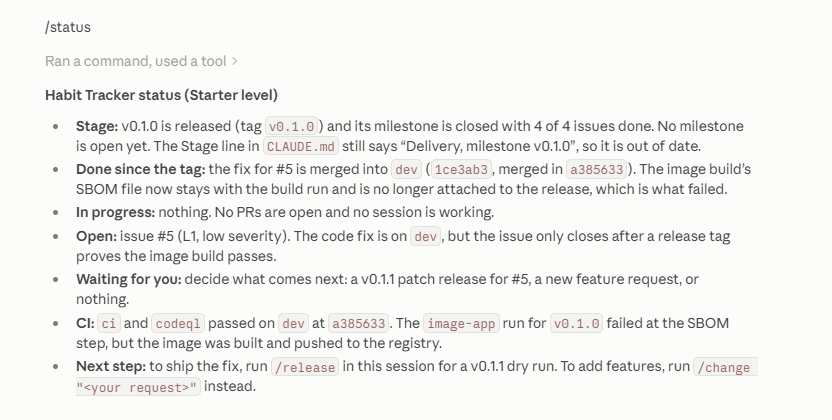

In that session the owner reported the narrow-window bug as a defect, then typed `/change Let me tick any of the last 7 days, in case I forgot to tick it that day.` The session opened CR #7 (L2), updated the SRS (FR-005) before any code, split it into two tasks, built and released v0.2.0, a new feature, so the minor version went up. The tag's image now has an SBOM and a build attestation:

```
gh attestation verify oci://ghcr.io/liquizzz/habit-tracker-app:v0.2.0 -R liquizzz/habit-tracker
```

It verifies: SLSA provenance v1, built by `image-app.yml` from tag `v0.2.0`.

The narrow-window fix, captured at 390 px wide: the names and dots now fit, but the Add and Today buttons are still cut off at the right edge.

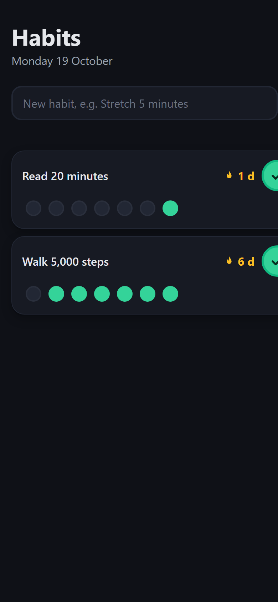

## What the owner did

The owner answered questions, picked the stack and the look, tried the acceptance scenarios, and approved the brief once, then twice for each release: the acceptance scenarios, and the push of `main` and the tag. Outside the sessions: enable Actions, set the board to public and to a board layout, and run two Docker commands.

## What went wrong, and what changed

| Found | Effect | Status |
|---|---|---|
| The interview was only AI-written menus, and moved on without a stop after the questions | The owner could not lead or approve before the next part | Fix planned: the owner describes first, the session asks only what is missing and suggests only when asked |
| Build and release felt long; each task waited for CI | Slower days | Fix planned: `/build dev` (no tests, no merge), `/build test` (tests at the task's level, merge), `/release demo`, `/release` |
| `scripts/release.mjs` ignored files with Windows line endings | CHANGELOG and SRS edited by hand in v0.1.0 | Fixed in the project (#10); fix planned in the kit |
| The kit's SBOM step failed on release tags | No attestation for v0.1.0 | Fixed in the project (#5); fix planned in the kit |
| Board items never moved between columns | The board showed no progress | Fix planned |
| No acceptance scenario for a narrow window | The layout broke below 600 px in v0.1.0 | Partly fixed in v0.2.0 (#6): at 390 px the buttons are still cut off. A narrow-window scenario is planned for `/release` |
| `/setup` pushed before turning on CodeQL | The first CodeQL run was skipped | Fix planned |

## Cost

Not measured in this run beyond the start: a new session began at 91k tokens of context, almost all of it from plugins and tools installed on that machine, not from the kit (the kit's own rules are about 3k). Per-step token counts and a comparison with plain Claude Code are left for the next run.

## Files to read in the repo

- Brief: [`docs/product/brief.md`](https://github.com/liquizzz/habit-tracker/blob/main/docs/product/brief.md)
- SRS: [`docs/tech/srs.md`](https://github.com/liquizzz/habit-tracker/blob/main/docs/tech/srs.md)
- Stack decision: [`docs/tech/adr/0001-stack.md`](https://github.com/liquizzz/habit-tracker/blob/main/docs/tech/adr/0001-stack.md)
- Release notes: [`docs/releases/`](https://github.com/liquizzz/habit-tracker/tree/main/docs/releases) · Changelog: [`CHANGELOG.md`](https://github.com/liquizzz/habit-tracker/blob/main/CHANGELOG.md)
- AI log: [`docs/ai-log.md`](https://github.com/liquizzz/habit-tracker/blob/main/docs/ai-log.md)
