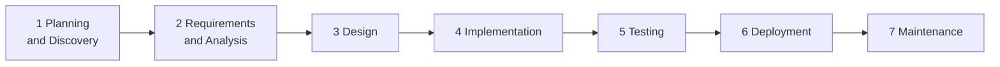

# AI-Driven Delivery Process

From business idea to production, with a team of AI agents (Claude Code sessions) doing the production work and one human owning every decision.

The process follows the classic software development life cycle (SDLC). Short projects (1–2 weeks) run it as **Waterfall**: each phase is completed and locked once, then the next phase starts. Worked examples: [AI chatbot](examples/ai-chatbot.md), [EA DCA Hedging](examples/ai-bot-ea-dca-hedging.md) (POC).

## Principles

1. **Human owns the decision, AI owns the draft.** AI produces options, documents, code and tests. A human approves anything that changes scope, architecture, cost or risk.
2. **Every phase ends at a gate.** A gate is a short checklist. The next phase starts only when the gate passes.
3. **Lock once.** A locked document is not reopened inside a short project. New ideas go to the next-phase backlog (see [Change control](#change-control)).
4. **Artifacts over chat.** Every decision lives in a file in the repo (proposal, PRD, spec, ADR, board), not in a chat transcript. Agents read those files as context in later phases.
5. **Docs lead code.** Code follows the approved spec. Code never runs ahead of an approved document.
6. **Log the process.** Every task gets a line in `docs/ai-log.md`: what the AI did, where the human intervened, how many rework loops.

## Life cycle

| # | Phase | Question it answers | AI does | Human does | Output | Gate |
|---|---|---|---|---|---|---|
| 1 | **Planning and Discovery** | What do we build, for whom, and is it worth it? | Interviews the human and the client's material; drafts options with effort, cost and risk; sets up the repo, `CLAUDE.md` and the secret-check hook | Chooses the option; agrees scope, budget and dates with the client | `docs/proposal.md` ([template](../templates/proposal.md)) | **G1 Proposal locked:** problem, users, chosen option, scope, success metric, timeline and budget agreed |
| 2 | **Requirements and Analysis** | What exactly must the product do? | Drafts the PRD from the proposal; analyses the real data (structure, rules, edge cases); writes user stories with acceptance criteria | Confirms the business rules; cuts scope; approves the PRD | `docs/prd.md` ([template](../templates/prd.md)), `docs/data-notes.md` ([template](../templates/data-notes.md)), `docs/stories/` ([template](../templates/user-story.md)) | **G2 Requirements locked:** must-haves, non-goals and measurable metrics fixed; every field the product needs is mapped to real data |
| 3 | **Design** | How will we build it? | Writes the spec and interface contracts from the UX inward; proposes architecture options; drafts ADRs, C4 diagrams, UI design, test strategy, eval plan and the implementation plan with roles | Chooses options; approves the UI, the contracts and the plan | `docs/spec.md` ([template](../templates/spec.md)), `docs/adr/` ([template](../templates/adr.md)), `docs/c4.md` ([template](../templates/c4.md)), `docs/design/`, `docs/test-strategy.md` ([template](../templates/test-strategy.md)), `docs/eval-plan.md` ([template](../templates/eval-plan.md)), `docs/roles.md` ([template](../templates/roles.md)), `docs/board.md` ([template](../templates/board.md)) | **G3 Design locked:** contracts fixed, each significant decision has an accepted ADR, UI approved, every task has an owner role and a done check |
| 4 | **Implementation** | Does it work? | Role sessions build per the plan with TDD: the thinnest end-to-end slice first, then each layer widened | Reviews diffs; keeps the build inside the spec | Code, unit tests, eval set | **G4 Build complete:** all planned tasks done; build, lint and unit tests pass |
| 5 | **Testing** | Does it meet the requirements? | Runs integration, end-to-end, load tests and the eval; first-pass code review; reports defects | Exploratory test of the main journeys; accepts the result | Test and eval report | **G5 Accepted:** every acceptance criterion covered; eval meets the pass marks; no open high-severity defects |
| 6 | **Deployment** | Is it live and safe? | Runs the release checklist; drafts release notes; prepares the demo or go-live | Approves the deploy; checks production | `docs/releases/<version>.md` ([template](../templates/release-checklist.md)) | **G6 Released:** checklist complete; smoke test passes |
| 7 | **Maintenance** | Does it keep working, and what next? | Monitors, fixes defects, runs scheduled jobs; drafts the case study and the next-phase backlog | Decides the next phase or iteration | `docs/case-study.md` ([template](../templates/case-study.md)) | Next iteration starts again at phase 1 or 2 |

Run `/gate <G#>` ([command](../kit/commands/gate.md)) in Claude Code to have the agent check a gate against the repo before asking the human to approve it.

## Ordering rules inside the phases

1. **Proposal before requirements.** The PRD is written from the locked proposal, never in parallel with it.
2. **Real data in Requirements.** The data analysis is part of G2, so the spec is written on real fields and rules, not guesses.
3. **Spec only in Design.** The spec, contracts and ADRs are written after G2 and approved together at G3. No production code before G3.
4. **Outside-in.** The UI flows are designed first; the API contract is written to serve them; back-end code follows the contract.
5. **Test plan before code.** The test strategy and eval plan (pass marks) are approved at G3; Implementation builds the tests together with the code.
6. **Vertical slice first.** The first implementation tasks deliver one thin path from data to screen; then each layer is widened.

## Agent sessions

Projects run as several Claude Code sessions, one per role. **A session is opened only when its phase starts**, and only for work that the locked documents already describe. Full rules: [agent-team.md](agent-team.md).

| Role session | Opened at | Work |
|---|---|---|
| **Lead** | Phase 1 | Proposal, PRD, spec, ADRs, plan, board, AI log, gates |
| **UI/UX** | Phase 3 | UI states, wireframes, prototype; front-end code in phase 4 |
| **Dev** | Phase 4 | Back-end code and unit tests |
| **DevOps** | Phase 4 | Local environment, data restore, pipeline; deployment in phase 6 |
| **Test** | Phase 4 | Test suites and eval set in phase 4; test and eval runs in phase 5 |

Each role session writes its own detailed plan (from the approved spec) as its first task, and works only in the paths it owns.

## Change control

Short projects do not change course mid-flight.

| Situation | What happens |
|---|---|
| A new idea or a "nice to have" after a gate | Goes to the **next-phase backlog** on the board. It is not built and does not change locked documents |
| A defect in a locked document that blocks the work (wrong rule, missing field) | A **change request** `CR-NN` on the board with its impact. The human decides once, in the daily review. The Lead corrects the document, then the code follows |
| A client request that changes scope | Recorded as a CR; quoted and planned as the next phase, unless the human accepts it with a new date |

## Daily rhythm

| When | Who | What |
|---|---|---|
| Start of day | Lead | Day plan on the board: current phase, open sessions, top tasks |
| During the day | Role sessions | Work only in owned paths; raise questions and CRs on the board |
| Daily review | Human | Answers open questions and decides CRs in one batch |
| End of day | Each role, then Lead | Roles update task status; the Lead closes answered questions, adds AI-log lines and reports progress |

## Where the human stays in control

- **Scope.** Only the human locks the proposal and the PRD and decides CRs (G1, G2).
- **Architecture and contracts.** Only the human accepts an ADR, the UI and the contracts (G3).
- **Merge and deploy.** Only the human approves commits to `main` and releases (G5, G6).
- **Secrets and data.** Agents never commit credentials; client data stays in the client's environment.

## Claude Code setup (per project)

- `CLAUDE.md` at the repo root ([sample](../kit/CLAUDE.md)): product summary, stack, conventions, commands, links to proposal, PRD, spec and ADRs.
- The secret-check hook installed before the first commit ([kit/hooks/pre-commit](../kit/hooks/pre-commit)).
- The `/gate` command in `.claude/commands/` ([kit/commands/gate.md](../kit/commands/gate.md)).
- `docs/roles.md` and `docs/board.md` once more than one session works on the repo ([agent-team.md](agent-team.md)).

## Time boxes

| Project | 1 Planning | 2 Requirements | 3 Design | 4 Implementation | 5 Testing | 6 Deployment |
|---|---|---|---|---|---|---|
| Weekend POC (~8h) | 0.5h | 0.5h | 1h | 4.5h | 1h | 0.5h |
| 1–2 week project (Waterfall) | 0.5–1 day | 0.5–1 day | 1 day | 3–6 days | 1–2 days | 0.5 day |
| Longer than 2 weeks | Phases 1–3 once, then iterations of 1–2 weeks, each running phases 2–6 on a slice | | | | | |
