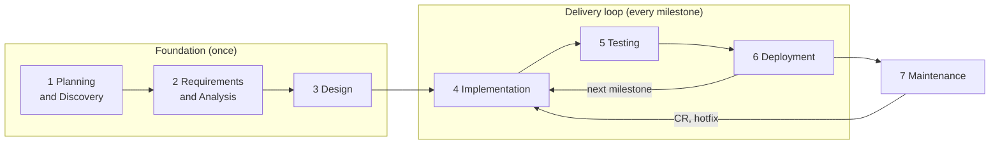

# AI-Driven Delivery Process

From business idea to production with one human and a team of AI agents (Claude Code sessions). The agents do the production work. The human, called **the owner**, makes every decision that changes scope, risk, money or what goes live.

The process follows the software development life cycle (SDLC) in two stages: a **Foundation** stage that runs phases 1–3 once, and a **Delivery loop** that runs phases 4–6 in small releases called **milestones**. How the role sessions work together day to day is in [agent-team.md](agent-team.md).

## Principles

1. **The owner decides, AI drafts.** AI produces options, documents, code and tests. The owner approves anything that changes scope, priority, risk, cost or production.
2. **Every phase ends at a gate.** A gate is a short checklist. Agents check it first with `/gate`; only the owner passes it.
3. **Change goes through a change request, never silently.** Documents are versioned, not frozen. Every change is a CR, and every CR updates the SRS.
4. **Decided means written.** A decision lives in a file or an issue the moment it is made (CR, DEC, ADR, SRS), never only in a chat.
5. **Docs lead code.** The SRS and the spec for a CR are merged before any task for that CR is assigned.
6. **Small, frequent releases.** A milestone holds a few CRs and ships within days. Late work moves to the next milestone instead of holding the release.
7. **Log the process.** Every task gets a line in `docs/ai-log.md`: what AI did, where the human stepped in, how much rework.

## Life cycle

| # | Phase | Question | Owner of the draft | Output | Gate |
|---|---|---|---|---|---|
| 1 | **Planning and Discovery** | What do we build, for whom, is it worth it? | PO | `docs/product/proposal.md` | **G1 Proposal approved:** problem, users, chosen option, scope, success metric, timeline and budget agreed; repo and kit set up |
| 2 | **Requirements and Analysis** | What exactly must it do? | PO | `docs/product/prd.md`, `docs/product/data-notes.md`, `docs/product/stories/` | **G2 Requirements approved:** must-haves, non-goals and measurable metrics fixed; product fields mapped to real data; every must-have has a story with testable acceptance criteria |
| 3 | **Design** | How will we build it? | Lead (UI/UX for the UI) | `docs/tech/srs.md` (baseline), `docs/tech/adr/`, `docs/tech/c4.md`, `design/`, `docs/tech/test-strategy.md`, `docs/tech/eval-plan.md`, first milestone plan | **G3 Design approved:** SRS baseline with FR/NFR IDs; accepted ADRs; UI approved (`design-v1`); test strategy and eval pass marks; GitHub board, labels and first milestone ready |
| 4 | **Implementation** | Does it work? | Dev, UI/UX, DevOps | Code and unit tests through PRs into `dev` | **G4 Milestone built:** every task in the milestone meets the Definition of Done |
| 5 | **Testing** | Does it meet the SRS? | Test | Test report `docs/tech/test-reports/vX.Y.Z.md` | **G5 Milestone accepted:** full regression on `staging` passes; no open high or medium defects |
| 6 | **Deployment** | Is it released and safe? | Lead | Tag `vX.Y.Z`, `CHANGELOG.md`, SRS revision, release summary `docs/releases/vX.Y.Z.md` | **G6 Released:** owner approved the release (`main` + tag) and, after 1.0.0, the deployment (`production`); smoke test passes |
| 7 | **Maintenance** | Does it keep working, what next? | Lead, PO | Hotfixes, next milestones, `docs/product/case-study.md` | New work re-enters the loop as a CR |

Run `/gate <G#>` ([command](../kit/commands/gate.md)) to have the agent check a gate before asking the owner.

## Ordering rules

1. **Proposal before requirements.** The PRD is written from the approved proposal.
2. **Real data in requirements.** Data analysis is part of G2, so the SRS is written on real fields and rules, not guesses.
3. **SRS before code.** The SRS baseline is approved at G3. After that, the SRS and the CR spec are merged into `dev` before a task is assigned.
4. **Outside-in.** UI flows first, the contract to serve them next, back-end code last.
5. **Test plan before code.** The test strategy and eval pass marks are approved at G3; tests are written with the code.
6. **Vertical slice first.** The first milestone delivers one thin path from data to screen; later milestones widen it.

## Documents

| Folder | Owner | Holds |
|---|---|---|
| `docs/product/` | PO | Proposal, PRD, data notes, stories, `cr/CR-<n>.md`, `dec/DEC-<n>.md`, `milestones/vX.Y.Z.md`, case study |
| `docs/tech/` | Lead | `srs.md`, `spec/CR-<n>.md`, `adr/`, `c4.md`, test strategy, eval plan; Test owns `test-cases/` and `test-reports/`; DevOps owns `ops/` |
| `docs/reports/` | PO | `YYYY-MM-DD.md`: morning brief and end-of-day report |
| `docs/releases/` | Lead | `vX.Y.Z.md`: release summary and checklist |
| `design/` | UI/UX | Prototype shown to the client |

- **The SRS is mandatory and always current.** It describes the system as it is now, gives every requirement a stable ID (`FR-021`, `NFR-004`) with its origin (`CR-12, since v1.4.0`), keeps a **Revision History** (SRS version, release, date, CRs, sections changed) and a traceability matrix (requirement ↔ CR ↔ issue ↔ test). Its version equals the release version.
- **A CR is drafted and approved as a GitHub issue.** When approved, the PO exports it to `docs/product/cr/CR-<issue number>.md`. The CR number is the issue number.
- **DEC** (business, PO) and **ADR** (technical, Lead) record the options considered and why each was rejected.

## Delivery loop

### Milestones
- A milestone is the next release: **a few CRs, a few days**; each project sets its own cadence in the proposal. Only one milestone is running; one more ("next") collects what is approved but not started. A GitHub milestone named `vX.Y.Z` tracks it.
- The plan is set every morning before 10:00 (PO brief, owner decides).
- A milestone ships when it is done, not on a fixed date.

### Buffer and risk
- The Lead estimates every task in half days with a confidence level. The committed date is the sum plus a **risk buffer**: +15% (all tasks certain), +25% (any L2 task or medium confidence), +40% (L3, new kind of work, or an outside dependency).
- Work added during the day is paid from the buffer. The end-of-day report always shows **buffer left**.
- Each milestone file has a risk table (risk, likelihood, impact, response, watcher) that the Lead updates daily.
- When the date is at risk: use the buffer → cut scope (PO moves the lowest-priority CR to the next milestone) → move the date (owner only).

### Intake during the day

| New item | Goes to | Decided by |
|---|---|---|
| High-severity defect in production | Hotfix, outside the milestone | Lead reports; owner approves the release |
| Defect found while testing the running milestone | Running milestone | Lead |
| L0–L1 CR that fits in the buffer | Running milestone | PO; reported in the end-of-day report |
| L2–L3 CR, or anything that would push the date by more than half a day | Next milestone | PO proposes; owner decides the next morning |
| A change of scope or priority | — | Owner, notified at once |

The running milestone only takes new work that does not move its release date.

## Versions and releases

### Version numbers
- **Semantic versioning** `MAJOR.MINOR.PATCH`. Every merge into `main` is a new version, hotfixes included. Staging builds have no version; they are identified by date and commit.
- **Computed from issue labels** by the `release` script over the milestone's closed issues: `breaking` → MAJOR, any `type:feature` or `type:change` → MINOR, only `type:fix` → PATCH. The PO labels each CR; the Lead runs the script and shows the number in the release summary; the owner approves it.
- **Before go-live** the project uses `0.x.y` and ignores `breaking`. `1.0.0` is the first version the owner declares live.
- **Breaking** (from 1.0.0, compared with the version in production): something that works in production stops working the same way, so users, other systems or data must change. Examples: a data migration, a changed or removed API, a different core user flow, a different result for the same input in a business rule (e.g. position sizing), a new required setting. A bug fix that makes the system match the SRS is not breaking. A breaking CR must include upgrade steps and a rollback plan.

### Release flow
1. Milestone done (G4) → Lead merges `dev` into `staging` → Test runs the full regression (G5).
2. Lead runs `release`: version, `CHANGELOG.md`, SRS Revision History, GitHub release notes. Lead sends the **release summary** to the owner:
   > **v1.4.0** (from v1.3.2) · MINOR · CR-12, CR-15 · Defects fixed: #88, #91 · SRS §3.2, §5.1 changed · Regression passed · Extra review: Codex, 3 findings, 2 fixed, 1 rejected · Risks: … · Buffer used: ½ day → **Approve / Approve and deploy / Reject**
3. **Owner approves the release** → Lead merges `staging` into `main` and tags `vX.Y.Z`.
4. **Owner approves the deployment** (can be the same answer) → Lead moves `production` to the tag and watches the result (G6).

Before go-live there is no `production` branch: releases stop at `main` with a `0.x.y` tag. Go-live creates `production` from a tag, turns on the production pipeline and declares `1.0.0`.

### Hotfix and rollback
- **Hotfix:** branch `hotfix/*` from `production`, fix, test, owner approves, tag `vX.Y.(Z+1)`, merge into `production` and `main`, then back into `staging` and `dev`.
- **Rollback:** first, redeploy the previous tag through the production pipeline (manual run, owner approves); then fix forward with a hotfix. Moving the `production` branch back to an older tag is allowed only with the owner's approval. Every rollback is recorded in the daily report and `CHANGELOG.md`.

## Daily rhythm

| When | Who | What | Owner's part |
|---|---|---|---|
| Before 10:00 | PO | Morning brief: yesterday, milestone status, new items, proposed plan, decisions needed | Decide the plan (~10 min) |
| During the day | Lead → team | Assign issues, review, merge, staging | Answer only at gates |
| End of day | Lead → PO → owner | Done · in progress · blocked · items taken in · buffer left · PRs waiting (count, oldest) · risks | Read; no reply needed |
| Milestone done | Lead | Release summary | Approve or reject |

Reports are saved in `docs/reports/YYYY-MM-DD.md`; the PO pushes them and sends the link, so they can be read from any device.

## Where the owner stays in control

- **Plan and scope:** the morning plan, every L2–L3 CR, any change of scope or priority, any moved date.
- **Releases:** every merge into `main` (release) and `production` (deployment, rollback).
- **Money, accounts and secrets:** logins, payments, credentials, deleting data. Agents never read or create secrets.
- **Extra reviews:** the owner chooses when an independent AI review (Codex or Claude `/code-review`) runs.

## Time boxes

| Project | Foundation (phases 1–3) | Delivery loop |
|---|---|---|
| Weekend POC (~8h) | ~2h | One milestone of ~6h |
| Small product (1–2 weeks) | 1.5–3 days | Short milestones |
| Larger product | 3–5 days | Short milestones; Foundation revisited only through CRs |
