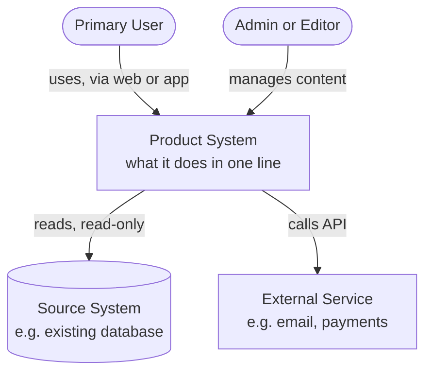
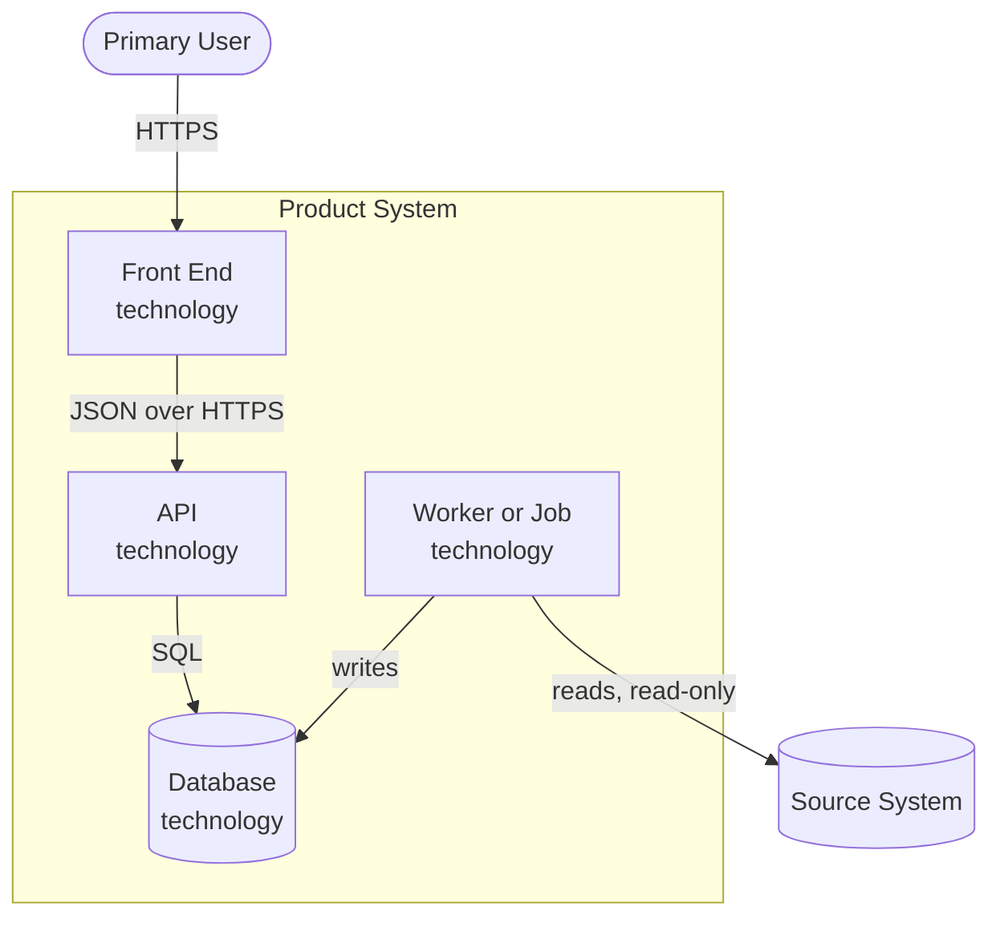

# C4 diagrams: <Project name>

Save as `docs/tech/c4.md`. Levels 1 and 2 of the [C4 model](https://c4model.com). GitHub renders the Mermaid blocks below. Replace every label in *Title Case* with your own names; keep the shapes: rounded boxes are people, cylinders are data stores.

## Level 1: System context
Who uses the system and which other systems it talks to.

## Level 2: Containers
The deployable parts and how they communicate.

## Notes
| Element | Responsibility | Related ADR |
|---|---|---|
| <API> | <...> | `docs/adr/0001-<slug>.md` |
